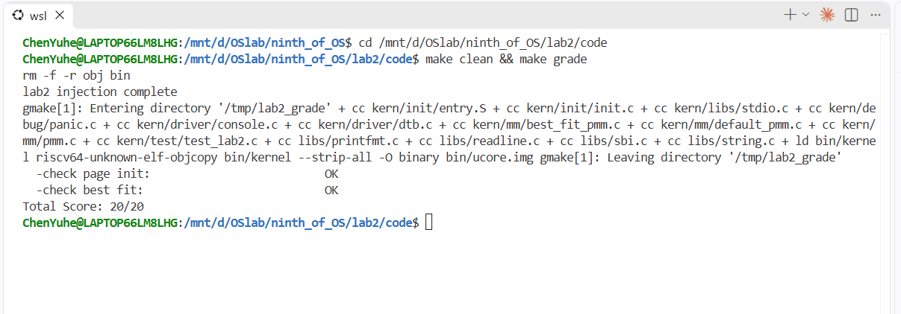
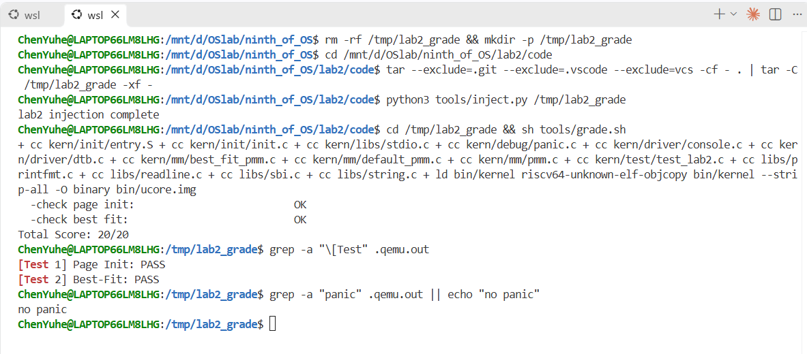

# 操作系统实验报告

## 实验基本信息

| 项目               | 内容                                           |
| ------------------ | ---------------------------------------------- |
| **实验名称** | Lab 2: 物理内存和页表                          |
| **小组成员** | 2413094-卢思齐、2414113-焦程远、2411617-陈彦冰 |
| **完成日期** | YYYY-MM-DD                                     |

### 小组分工

| 成员           | 负责的练习/模块                                                                                        |
| -------------- | ------------------------------------------------------------------------------------------------------ |
| 2413094-卢思齐 | 模块一任务一<实现物理内存探测与页描述符初始化功能>、  模块二任务一<理解first-fit 连续物理内存分配算法> |
| 2411617-陈彦冰 | 模块二任务二<实现 Best-Fit 连续物理内存分配算法>                                                       |
| 2414113-焦程远 | 模块二任务三<buddy system（伙伴系统）分配算法>                                                         |

---

## 一、实验目的

本实验的主要目的是：

1. 理解页表的建立和使用方法
2. 理解物理内存的管理方法
3. 理解页面分配算法

---

## 二、实验环境

你们使用的 AI 工具

| 成员           | AI 编程工具                                                                   | 底层模型                                                  | 备注               |
| -------------- | ----------------------------------------------------------------------------- | --------------------------------------------------------- | ------------------ |
| 2413094-卢思齐 | Copilot（VS Code插件）                                                        | DeepSeek-V4-pro                                           | 自定义Agent        |
| 2411617-陈彦冰 | [例如：Cline（VS Code插件） / Claude Code（终端 Agent） / DeepSeek Harness等] | [例如：Claude Sonnet 4.5 / GPT-5.5 / DeepSeek-V4-Flash等] | [可选：特殊配置等] |
| 2414113-焦程远 | Copilot（VS Code插件）                                                        | DeepSeek-V4-pro                                           | [可选：特殊配置等] |

**说明：**

- **AI 编程工具**：指具体使用的终端工具、编辑器插件、桌面应用或浏览器界面
- **底层模型**：指该工具使用的大语言模型及版本

---

## 三、实验整体逻辑分析

### 2.1 本章节的逻辑主线

- 本章实验围绕“物理内存的探测、初始化与页级分配管理”这一核心主题展开。操作系统必须先从硬件获取可用的物理内存范围，建立统一的数据结构（`Page`描述符）进行记录，并在此基础上提供不同策略的连续物理页分配接口。
- 整个实验解决了内核如何“识别并管好物理内存”的问题。从最基础的物理页初始化开始，再到寻找最匹配块的Best-Fit算法，然后提升合并效率的Buddy System算法，最终我们小组构建出一个高效、抗碎片的页级内存分配体系，为后续的虚拟内存管理和进程运行打下坚实的物质基础。

### 2.2 功能的逐步实现

本实验严格遵循从底层探测到上层算法优化的依赖关系逐步实现，具体顺序及原因如下：

1. 首先实现物理内存探测与页描述符初始化功能

   - 物理内存探测与页描述符初始化功能是所有内存管理的物理基石。系统刚启动时，必须先通过设备树（DTB）摸清家底，获取真实的物理内存范围。然后建立`struct Page`描述符数组，把 OpenSBI、内核镜像自身以及描述符数组本身占用的空间“挖除”并标记为保留（`Reserved`）。只有把剩余的真实空闲页连成初始的空闲链表，后续的分配器才能知道有多少空闲可分。
2. 然后实现Best-Fit连续物理内存分配算法

   - 有了空闲链表后，系统需要最基础的按页分配能力。First-Fit算法虽然简单，但在低地址容易产生大量小碎片。Best-Fit算法通过遍历空闲链表，寻找大小最接近请求需求的块进行分配，从而尽量保留大块空闲内存，有效降低了外部碎片的产生率。
3. 最后完成buddy system（伙伴系统）分配算法

   - 虽然 Best-Fit 能减少碎片，但其基于链表的线性查找和合并效率较低。Buddy System引入了“块大小必须是 2 的幂次方”的管理机制，利用位运算快速寻找“伙伴”块，使得内存分配和合并的时间复杂度大幅降低。它解决了频繁申请和释放内存时的性能瓶颈与碎片问题，最终构成了本次实验完整的物理内存分配闭环。

---

## 四、实验内容与实现

### 功能模块一：物理内存初始化功能

**负责人：** 2413094-卢思齐

#### 模块功能描述

**需要实现/修改的函数：**

```c
static void page_init(void); (kern/mm/pmm.c)
```

**功能说明：**

- 该模块在整个系统中的作用

  - `page_init()`是内核物理内存管理的基石。它的核心作用是将底层硬件探测到的物理内存资源，转化为操作系统可以理解和管理的软件数据结构。它负责建立`struct Page`描述符数组，确立虚拟地址与物理地址之间的转换偏移量（`va_pa_offset`），并计算出可管理物理内存的页号上界（`npage`）。只有该模块成功执行，后续的所有内存分配接口才能真正工作。
- 需要处理的主要场景

  1. 正常初始化场景：读取设备树（DTB）提供的内存信息，计算描述符数组所需的空间；将内核镜像、OpenSBI 以及描述符数组自身占用的页面排除，将剩余的完整空闲页面注册给物理内存管理器。
  2. 边界与截断场景：当硬件实际内存大于内核框架允许的最大管理上界时，需要对物理内存末端进行向下截断对齐。
  3. 异常处理场景：当设备树信息无效（如基址或大小为 0）时，必须通过 `panic() `终止初始化；当扣除各种占用后没有完整的空闲页时，必须安全退出，不能错误地调用空闲区注册函数。
- 与其他模块的交互关系

  1. 与底层驱动（DTB）的交互：调用`get_memory_base() `和 `get_memory_size()` 获取由设备树解析出来的物理内存起点和大小。
  2. 与链接器和启动代码的交互：利用链接符号`end`确定内核代码的结束位置，从而安全地计算并分配`Page`描述符数组的起始地址，防止覆盖内核代码。
  3. 与物理内存分配器（`pmm_manager`）的交互：在完成全局变量（`pages`、`npage`、`va_pa_offset`）的设置后，通过调用统一的 `init_memmap()` 接口，将计算好的空闲区起点和页数传递给具体的分配算法（如First-Fit或 Best-Fit），完成空闲链表的初始化。

#### 最终提示词

以下是经过迭代优化后，最终成功实现该功能的提示词：

```markdown
任务：修改pmm.c文件，实现或补全static void page_init(void)函数，完成物理内存探测与Page描述符初始化功能。该函数由pmm_init()调用，不接收参数，也不返回结果。成功后应为后续页面分配提供正确的初始状态。

操作要求：你必须在项目中修改实际文件，而不是仅展示代码。保留pmm.c中的现有代码，只在//lab2 function1 YOUR CODE标记位置或明确需要补全的位置插入实现。不要删除既有逻辑，不要改动公开接口，不要修改pmm.c以外的文件。

输出要求：直接进行文件操作。使用下面[RELY]、[GUARANTEE]、[SPECIFICATION]部分提供的信息。以工程真实代码为准，不要引入无关功能，不要自行发明宏、结构体字段或函数签名。

[RELY]
//宏定义（来自mmu.h / memlayout.h / pmm.h）
#define PGSIZE          4096
#define PGSHIFT         12
#define PPN(la)         (((uintptr_t)(la)) >> PGSHIFT)

#define KERNBASE            0xFFFFFFFFC0200000
#define KMEMSIZE            0x7E00000
#define KERNTOP             (KERNBASE + KMEMSIZE)
#define PHYSICAL_MEMORY_END         0x88000000
#define PHYSICAL_MEMORY_OFFSET      0xFFFFFFFF40000000
#define KERNEL_BEGIN_PADDR          0x80200000
#define KERNEL_BEGIN_VADDR          0xFFFFFFFFC0200000

#define PG_reserved                 0
#define PG_property                 1
#define SetPageReserved(page)       ((page)->flags |= (1UL << PG_reserved))
#define ClearPageReserved(page)     ((page)->flags &= ~(1UL << PG_reserved))
#define PageReserved(page)          (((page)->flags >> PG_reserved) & 1)
#define SetPageProperty(page)       ((page)->flags |= (1UL << PG_property))
#define ClearPageProperty(page)     ((page)->flags &= ~(1UL << PG_property))
#define PageProperty(page)          (((page)->flags >> PG_property) & 1)

#define PADDR(kva)                                                 \
    ({                                                             \
        uintptr_t __m_kva = (uintptr_t)(kva);                      \
        if (__m_kva < KERNBASE) {                                  \
            panic("PADDR called with invalid kva %08lx", __m_kva); \
        }                                                          \
        __m_kva - va_pa_offset;                                    \
    })

//数据结构（来自memlayout.h）
struct Page {
    int ref;                        // page frame's reference counter
    uint64_t flags;                 // array of flags that describe the status of the page frame
    unsigned int property;          // the num of free block, used in first fit pm manager
    list_entry_t page_link;         // free list link
};

//全局变量（来自pmm.c / pmm.h）
struct Page *pages;                 // virtual address of physical page array
size_t npage = 0;                   // amount of physical memory (in pages), 物理页号上界
uint64_t va_pa_offset;              //虚拟地址与物理地址之间的偏移
const size_t nbase = DRAM_BASE / PGSIZE;   // DRAM_BASE = 0x80000000，nbase = 0x80000
const struct pmm_manager *pmm_manager;

//可用函数
static void init_memmap(struct Page *base, size_t n);   //内部封装，调用 pmm_manager->init_memmap
static inline struct Page *pa2page(uintptr_t pa);
static inline uintptr_t page2pa(struct Page *page);
static inline ppn_t page2ppn(struct Page *page);
void panic(const char *fmt, ...);
void cprintf(const char *fmt, ...);

//设备树接口（来自dtb.h）
extern uint64_t boot_hartid;
extern uint64_t boot_dtb;
void dtb_init(void);
uint64_t get_memory_base(void);
uint64_t get_memory_size(void);

//时序说明：
// kern_init()中先调用 dtb_init()，再调用pmm_init()；
//因此page_init()执行时，DTB解析已经完成。
//但如果DTB解析失败，dtb.c中的 memory_base/memory_size 仍为 0，
//所以page_init()必须检查 get_memory_base() 和 get_memory_size() 的返回值是否有效。

//链接符号
extern char end[];   // 内核镜像结束位置的虚拟地址

//页面对齐：若工程已有 PGROUNDUP/PGROUNDDOWN 宏则直接使用；
//若没有，可用以下等价写法：
//向上对齐：((uintptr_t)(addr) + PGSIZE - 1) & ~(PGSIZE - 1)
//向下对齐：((uintptr_t)(addr)) & ~(PGSIZE - 1)

[GUARANTEE]
必须实现或修改的接口：
static void page_init(void);

你可以根据需要添加：
-辅助函数（建议设为static，仅在本模块内部使用）
-内部使用的宏定义
-模块内部的静态变量

不允许：
-修改page_init的签名
-修改pmm.c以外的文件
-删除或重写现有公开接口
-引入与物理内存初始化无关的功能

[SPECIFICATION]

## page_init

Pre-Condition:

- pmm_init()已经调用init_pmm_manager()，pmm_manager已指向 default_pmm_manager并完成init()。
- dtb_init()已经执行，设备树内存信息已保存，get_memory_base()和 get_memory_size()可返回有效的物理内存基址与大小。
- 全局变量 pages、npage、va_pa_offset已声明，但 page_init()负责设置它们的正确初始值。
- 链接符号end可用于确定内核镜像结束的虚拟地址。
- 当前pmm_manager已就绪，可以通过init_memmap()注册空闲页面。
- 此时CPU已开启 Sv39 分页，代码运行在虚拟地址空间，PADDR可用于虚拟地址到物理地址的转换，但使用前必须先设置 va_pa_offset。

Post-Condition:

- va_pa_offset正确反映虚拟地址与物理地址之间的转换关系，使得 PADDR(KERNBASE)等于KERNEL_BEGIN_PADDR（即 0x80200000）。
- npage正确表示内核可管理的物理页号上界，且满足pa2page()对物理地址的有效性检查。
- pages指向正确布局的Page描述符数组，数组覆盖物理页号区间 [nbase, npage)，且描述符数组本身占用的物理页面不会被注册为空闲页面。

-在建立空闲区之前，所有Page描述符都已处于保留状态，防止尚未完成布局的页面被提前分配。

-当前pmm_manager只接管排除OpenSBI、内核镜像和Page描述符数组占用空间后、按页对齐的完整空闲页面。

-通过cprintf()输出设备树探测到的物理内存范围。

-如果初始化过程中发现设备树信息无效，则通过panic()终止初始化。

-如果没有可用完整页面，则不调用init_memmap()。

Case 1：正常初始化

-当get_memory_base()和get_memory_size()返回有效的物理内存基址和大小，且可管理上界、页面对齐、已用空间排除后仍存在至少一个完整空闲页面时，page_init()应完成va_pa_offset、npage、pages的设置，计算Page描述符数组布局，排除OpenSBI、内核镜像和描述符数组占用的页面，并将剩余完整空闲页面通过init_memmap()交给当前pmm_manager管理。

Case 2：物理内存上界需要限制

-当设备树提供的物理内存范围超过框架允许的可管理上界 PHYSICAL_MEMORY_END时，page_init()应将可管理物理内存上界限制到 PHYSICAL_MEMORY_END，而不是直接使用设备树给出的原始上界。后续 npage、pages和空闲区注册都应基于限制后的上界进行。

Case 3：设备树信息无效

-当get_memory_base()或get_memory_size()返回无效信息，例如基址为0、大小为0、范围明显不合法或无法满足基本对齐要求时，page_init()应通过 panic()终止初始化，而不是继续使用错误信息建立描述符布局。

Case 4：没有可用完整页面

-当排除OpenSBI、内核镜像和Page描述符数组占用空间后，剩余空间不足以形成一个按页对齐的完整空闲页面时，page_init()不应调用init_memmap()。此时仍应保证已设置的全局状态不会让后续分配器误以为存在可用空闲页面。

Requirements:
-必须区分虚拟地址、物理地址、物理页号和Page描述符地址，不能混用。
-必须先设置va_pa_offset，再使用PADDR宏，否则PADDR会因 va_pa_offset未初始化而失败。

- va_pa_offset应设置为PHYSICAL_MEMORY_OFFSET或KERNBASE - KERNEL_BEGIN_PADDR，即 0xFFFFFFFF40000000。
- npage应基于限制后的物理内存上界计算，即 npage = 可管理物理内存上界 / PGSIZE，且为物理页号上界。
- pages数组起点应位于end之后并按页向上对齐，数组长度为npage - nbase，每个struct Page对应物理页号nbase +下标。

-必须先将所有描述符设置为保留状态（SetPageReserved），再通过 init_memmap()把空闲区页面转为非保留并加入空闲链表。

-必须确保OpenSBI占用区 [0x80000000, 0x80200000)、内核镜像、Page描述符数组都不会进入空闲区。

-空闲区起点为描述符数组末尾物理地址向上按页对齐，空闲区终点为设备树上界截断到PHYSICAL_MEMORY_END后向下按页对齐；只有起点小于终点时才调用init_memmap()。

-输出信息使用cprintf()，可参考格式：

cprintf("physical memory map:\\n  memory: 0x%016lx, [0x%016lx, 0x%016lx].\\n", mem_base, mem_base, mem_base + mem_size - 1);

-错误终止使用 panic()。

-辅助函数如果新增，应设为static，且不得改变公开接口。
```

#### 实现迭代过程

本模块的实现经历了 [N] 次迭代，过程如下：

---

##### 第一次迭代

如果设计的prompt生成代码后出现问题：

**遇到的问题：**

- 问题1：问题描述、错误信息和原因分析
- 问题2：问题描述、错误信息和原因分析

**问题解决策略：**

- 针对问题1：[说明如何修改提示词]
- 针对问题2：[说明如何修改提示词]

如果没有问题：

**最终结果：**

经过 [N] 次迭代，该模块最终：

- ✅ 编译通过
- ✅ 所有相关测试通过
- ✅ 功能符合预期

**关键改进点总结（如有）：**

1. [改进点1：例如，在 [RELY] 中补充了完整的系统调用号定义]
2. [改进点2：例如，在 [SPECIFICATION] 中明确了异常处理的边界条件]
3. [改进点3：例如，增加了对用户指针合法性检查的要求]

---

##### 第二次迭代（如有）

[按照和第一次迭代相同的格式]

---

##### 第三次迭代（如有）

[按照和第一次迭代相同的格式]

---

### 功能模块二：物理内存分配功能

#### 任务二：实现 Best-Fit 连续物理内存分配算法

**负责人：** 2411617-陈彦冰

#### 模块功能描述

**需要实现/修改的函数：**

```c
// 列出本模块涉及的所有函数签名
void example_function(void);
int another_function(int arg);
```

**功能说明：**

- 该模块在整个系统中的作用
- 需要处理的主要场景
- 与其他模块的交互关系

#### 最终提示词

以下是经过迭代优化后，最终成功实现该功能的提示词：

```markdown

完成操作系统实验lab2的“Best-Fit 连续物理内存分配算法”。只允许在lab2文件夹 @lab2/ 中工作。
下面已给出只读核对过的事实清单，请直接按事实实现，不要臆造字段或宏。实现前请先核对 best_fit_pmm.c 第 1-10 行的 include 与现有声明。

【Prompt任务说明】
任务详情：
在 kern/mm/best_fit_pmm.c 中补全完整的 Best-Fit 物理内存管理模块，并在 kern/mm/pmm.c 的 init_pmm_manager() 中将 pmm_manager 切换为 best_fit_pmm_manager。Best-Fit 核心：分配连续 n 页时扫描所有空闲块，选择 property >= n 且 property 最小的块；若多个块 property 相同，选择物理地址更小者。不得实现为“遇到第一个满足就返回”的 First-Fit。

当前构建状态（重要）：
- best_fit_pmm.c 目前只有 basic_check() 和 best_fit_check()，引用了未定义的 free_list/nr_free，且全仓库没有 best_fit_pmm_manager 定义；当前代码编译和链接都会失败。
- Makefile 第 33 行使用 -Werror，任何警告都会终止构建。
- 只有 make grade 会通过 tools/inject.py 把测试注入并运行；make / make qemu 不会跑测试。
- 一旦把 pmm.c:37 切到 best_fit 但 init_memmap 还是空壳，page_init 会在 pmm.c:128 崩溃，连 Test 1 也会丢。

操作约束：
1. 只允许修改两个文件的两个位置：
   - kern/mm/best_fit_pmm.c：在 `//lab2 function2-2 YOUR CODE`（第 6 行）之后、basic_check()（第 10 行）之前插入 static free_area_t、free_list/nr_free 宏和 5 个管理函数；best_fit_pmm_manager 的定义放在文件末尾、best_fit_check() 之后。
   - kern/mm/pmm.c：只允许把第 37 行 `pmm_manager = &default_pmm_manager;` 改为 `pmm_manager = &best_fit_pmm_manager;`。不要加 include、不要加 extern 声明、不要改该函数其他逻辑。
2. 严禁修改：
   - best_fit_pmm.c 中 basic_check()（10-58 行）和 best_fit_check()（61-138 行）的任何一行；
   - default_pmm.c 的任何内容；
   - pmm.h、memlayout.h 中 struct pmm_manager / struct Page / 状态宏 / le2page / free_area_t；
   - pmm.c 中 page_init()、pmm_init() 的结构与调用顺序；
   - best_fit_pmm.h 的 extern 声明；
   - tools/ 下所有文件（含 grade.sh、inject.py、test_lab2.c/h）；
   - Makefile 的任何目标或编译选项，禁止加 -Wno-error、禁止手动加入 kern/test 或 test_lab2.h。
3. 必须保证零警告通过 -Werror：不得有未使用变量、隐式函数声明、函数指针签名不匹配、有符号/无符号比较告警、未初始化变量。
4. 保留工程语义：沿用 default_pmm.c 状态约定——free_list 只挂空闲块头，块头 property 表示连续空闲页数且 PageProperty=1，非块头 property=0 且 PageProperty=0，链表按物理地址升序，nr_free 恒等于各块 property 之和，已分配块头 PageProperty=0 且 alloc 不改 ref。
5. 不引入 malloc、动态数组、C++ 特性或额外全局数据结构；链表扫描即可。
6. 输出要求：先给 5 行以内实现思路；再给 best_fit_pmm.c 的完整可粘贴代码（标出插入位置）；再给 pmm.c 的一行 diff；最后给验证命令和自检清单。不要输出伪代码。

输出验证要求：
代码必须能通过 make clean && make grade；输出中必须出现两行精确文本：
  [Test 1] Page Init: PASS
  [Test 2] Best-Fit: PASS
且 best_fit_check 不得 panic。注意 check_alloc_page() 会在 test_page_init()/test_best_fit() 之前调用当前 manager 的 check，因此 best_fit_check 必须先全部通过，否则两行 PASS 都打不出来；Test 2 PASS 隐含 best_fit_check 通过，不只是指针相等。若无法运行，明确说明我应在 VSCode 终端执行哪些命令。

【Rely依赖说明】
只使用以下最小依赖，不要扩散阅读无关模块：
- kern/mm/pmm.h：struct pmm_manager 的 7 个字段依次为 name、init、init_memmap、alloc_pages、free_pages、nr_free_pages、check；签名分别为 void(void)、void(struct Page*, size_t)、struct Page*(size_t)、void(struct Page*, size_t)、size_t(void)、void(void)。pmm_manager 为 extern 全局指针。
- kern/mm/memlayout.h：struct Page 字段为 int ref、uint64_t flags、unsigned int property、list_entry_t page_link；PG_reserved=0、PG_property=1；宏为 SetPageReserved/ClearPageReserved/PageReserved、SetPageProperty/ClearPageProperty/PageProperty；le2page(le, member) 在此文件定义；free_area_t 为 { list_entry_t free_list; unsigned int nr_free; }。
- kern/mm/default_pmm.c：只作状态约定参考，不得修改。重点看 :6-9 的 static free_area_t + free_list/nr_free 宏写法、:11-15 init、:17-43 init_memmap、:45-73 alloc_pages、:75-123 free_pages。
- kern/mm/best_fit_pmm.c：实现文件。当前只有两个 check，缺少 free_area_t 变量、free_list/nr_free 宏、5 个管理函数、best_fit_pmm_manager 定义；basic_check 直接使用 free_list 和 nr_free，因此这两个名字必须在 basic_check 之前定义（仿 default_pmm.c:6-9），否则编译失败。
- kern/mm/best_fit_pmm.h：第 6 行已 extern 声明 const struct pmm_manager best_fit_pmm_manager；pmm.c 第 2 行已 include 此头文件。best_fit_pmm_manager 必须在 best_fit_pmm.c 中给出定义，否则链接失败。
- kern/mm/pmm.c：只读 init_pmm_manager()，第 37 行是选择语句；page_init 在 pmm.c:128 调用当前 manager 的 init_memmap，切换 manager 后该函数必须完整可运行。
- libs/list.h：使用已有 list_init、list_add、list_add_before、list_del、list_next、list_prev、list_empty、list_entry 等接口；le2page 在 memlayout.h，不在 list.h。
不确定字段或宏时，先在上述文件中搜索已有用法，不要猜测。

【Guarantee接口清单】
必须交付：
1. static void best_fit_init(void);
2. static void best_fit_init_memmap(struct Page *base, size_t n);
3. static struct Page *best_fit_alloc_pages(size_t n);
4. static void best_fit_free_pages(struct Page *base, size_t n);
5. static size_t best_fit_nr_free_pages(void);
6. 在文件末尾、best_fit_check() 之后定义 const struct pmm_manager best_fit_pmm_manager，name 为 "best_fit"，7 个字段顺序与 pmm.h 完全一致，check 指向 best_fit_check。
7. 在 YOUR CODE 位置（第 6 行后、basic_check 前）补上 static free_area_t free_area; 以及 free_list、nr_free 宏（仿 default_pmm.c:6-9），确保 basic_check 能编译；再放 5 个管理函数。
8. pmm.c 第 37 行改为 &best_fit_pmm_manager。
允许新增 static 辅助函数；不允许新增不必要的全局符号，不允许给 basic_check/best_fit_check 加前向声明或改动其定义。

【Specification行为规格】
A. best_fit_init()
前置：pmm_manager 已选定，尚未注册空闲内存。
后置：list_init(&free_list)，nr_free = 0；不注册任何页面。

B. best_fit_init_memmap(struct Page *base, size_t n)
前置：base 为连续物理页起始，n 为可管理完整页数；调用方保证这些页可交给 pmm_manager。沿用 default_pmm.c:22 的约定，可断言每页 PageReserved 为真。
后置：逐页 flags=property=0、ref=0；仅块头 base->property=n 并 SetPageProperty(base)；nr_free += n；将 [base, base+n) 作为单个空闲块按物理地址升序插入 free_list。
分支：n==0 直接返回，不改链表和计数；链表为空直接插入；否则按 base 地址找到插入位置。
注意：切换 pmm.c:37 后 page_init 会调用此函数，必须完整可运行，不能是空实现或 NULL。

C. best_fit_alloc_pages(size_t n)
前置：n 为请求连续页数。
后置：成功时返回满足 property>=n 的块中 property 最小者；property 相同时选物理地址更小者（推荐，测试未显式断言 tie-break）；返回块从 free_list 删除，块头 ClearPageProperty；若选中块 property>n，剩余块起始为 page+n，property=原值-n，SetPageProperty，并按地址升序插回；nr_free -= n；不改 ref。
分支：n==0 返回 NULL；遍历 free_list 找不到 property>=n 的块返回 NULL；失败时不得改动 free_list、property、nr_free。不能只判断 n<=nr_free，必须实际遍历链表——best_fit_check:87-89 会在 nr_free 尚未清零、链表被 list_init 后断言 alloc_page()==NULL，若仅凭 nr_free 判断会失败。不得跨非连续页拼块，alloc_pages(4) 在只有 2 页块和 1 页块时必须返回 NULL。

D. best_fit_free_pages(struct Page *base, size_t n)
前置：base 为此前由 alloc 返回的连续块起始，n>0，该块当前不在 free_list。建议沿用 default_pmm.c:80 的断言 assert(!PageReserved(p) && !PageProperty(p))，因此 alloc 必须已清返回块头的 PageProperty。
后置：逐页 flags=0、ref=0；base->property=n 并 SetPageProperty；nr_free += n 仅一次；按地址升序插入 free_list；随后先与前驱合并（prev + prev->property == base），再与后继合并（base + base->property == next），被吸收块 ClearPageProperty 并 list_del；合并后仅最终块头保留 property 和 PageProperty，非块头 property=0 且清 PageProperty；合并不得重复增加 nr_free。
分支：n==0 直接返回；free_list 为空直接插入；不得破坏地址升序；best_fit_check:102 要求 free(p0+1,2) 后 p0[1].property==2 且 PageProperty(p0+1) 为真，且不能把 p0+1..2 与 p0+4 合并（p0+3 仍已分配）。

E. best_fit_nr_free_pages()
后置：返回当前空闲页总数，必须与 init_memmap/alloc/free 的增减严格一致。

F. best_fit_pmm_manager 与 pmm.c
要求：manager 定义在文件末尾，7 个字段顺序与 pmm.h 一致；pmm.c 只改第 37 行。不要改 pmm.c 的 include 或其他逻辑，不要改 best_fit_pmm.h。

验证与自检：
生成后请自检：basic_check()/best_fit_check() 零改动；default_pmm.c、pmm.h、memlayout.h、tools/、Makefile 零改动；pmm.c 只改第 37 行；代码在 -Werror 下零警告；alloc 失败路径不改链表；alloc 必须遍历链表而非只看 nr_free；free 合并后 nr_free 不重复；链表保持地址升序；property 只在空闲块头有效；alloc 返回块头并清 PageProperty；init_memmap 完整可运行；best_fit_pmm_manager 已定义。最后给出分两步验证的建议：
  第一步：先不切 pmm.c:37，cd lab2/code && make clean && make grade，预期 Test 1 PASS、Test 2 FAIL，确认构建、链接和 page_init 正常；
  第二步：再应用 pmm.c 一行 diff，make clean && make grade，预期两行 PASS，且 best_fit_check 不 panic。
并提醒我：make grade 会 clean 并复制到 /tmp/lab2_grade，跑前保存修改；make 与 make grade 切换前必须 make clean。
```

#### 实现迭代过程

本模块的实现经历了 [N] 次迭代，过程如下：

---

##### 第一次迭代

如果设计的prompt生成代码后出现问题：

**遇到的问题：**

- 问题1：问题描述、错误信息和原因分析
- 问题2：问题描述、错误信息和原因分析

**问题解决策略：**

- 针对问题1：[说明如何修改提示词]
- 针对问题2：[说明如何修改提示词]

如果没有问题：

**最终结果：**

经过 [N] 次迭代，该模块最终：

- ✅ 编译通过
- ✅ 所有相关测试通过
- ✅ 功能符合预期

**关键改进点总结（如有）：**

1. [改进点1：例如，在 [RELY] 中补充了完整的系统调用号定义]
2. [改进点2：例如，在 [SPECIFICATION] 中明确了异常处理的边界条件]
3. [改进点3：例如，增加了对用户指针合法性检查的要求]

---

##### 第二次迭代（如有）

[按照和第一次迭代相同的格式]

---

##### 第三次迭代（如有）

[按照和第一次迭代相同的格式]

---

#### 任务三：buddy system（伙伴系统）分配算法

**负责人:** 2414113-焦程远

#### 模块功能描述

**需要实现/修改的函数：**

```c
// kern/mm/buddy_pmm.c（新建）
static int   buddy_get_order(size_t n);              // ceil(log2 n)，n 页所需的阶
static void  buddy_init(void);                       // 初始化 16 个按阶划分的空闲链表
static void  buddy_init_memmap(struct Page *base, size_t n);   // 空闲区切成 2 的幂块
static struct Page *buddy_alloc_pages(size_t n);     // 向上取整 + 逐级分裂
static void  buddy_free_pages(struct Page *base, size_t n);    // 释放 + 伙伴合并
static size_t buddy_nr_free_pages(void);             // 统计空闲页总数
static void  buddy_check(void);                      // 自建测试区的正确性测试
const struct pmm_manager buddy_pmm_manager = { ... }; // 注册管理器（check = buddy_check）

// kern/mm/buddy_pmm.h（新建）
extern const struct pmm_manager buddy_pmm_manager;
```

**功能说明：**

- 该模块在整个系统中的作用

  Buddy System 把可用物理内存划分为**大小必须是 2 的 n 次幂**的存储块（1、2、4、8…页）进行管理。
  本模块实现了完整的伙伴系统分配器并注册为 `struct pmm_manager`：分配时把请求页数向上取整到 2 的幂，
  从高阶块逐级**分裂**；释放时用位运算 `ppn ^ (1 << order)` 直接定位**伙伴**，伙伴空闲则**合并**升阶。
  相比 First-Fit/Best-Fit 的线性扫描，伙伴系统的分配与合并都是 O(log N)（本机 N≤2^15，即常数次循环），
  是三种算法中时间效率最高的方案。
- 需要处理的主要场景

  1. 任意页数的请求：`n` 向上取整到 `2^ceil(log2 n)`（3 页占 4 页额度、70 页占 128 页额度），内部碎片换取 O(log N)；
  2. 空闲区的初始切块：总页数一般不是 2 的幂（本机 31930 页），需按二进制展开切成多个 2 的幂块；
  3. **块首对齐**：伙伴位运算成立的前提是块首按 `2^order` 对齐，切块时必须检查并对不齐的块降阶；
  4. 伙伴合并：释放时循环检查 `ppn ^ (1 << order)` 处的伙伴是否空闲且同阶，合并后块首取地址较小者；
  5. 边界：请求超过最大块（2^15 页）或超过总空闲页时返回 NULL；释放保留页（内核/页表占用）时断言失败。
- 与其他模块的交互关系

  1. 与 `pmm.c` 的交互：`init_pmm_manager()` 把全局 `pmm_manager` 切换为 `buddy_pmm_manager` 后，
     `page_init()` 把探测到的空闲页通过 `init_memmap()` 交给本模块，`check_alloc_page()` 调用 `buddy_check()`；
  2. 与 `memlayout.h`/`pmm.h` 的交互：复用 `free_area_t`（链表 + 计数）、`Page`（用 `property` 记录阶，
     `flags` 记录 `PageProperty`）、`page2ppn/pa2page` 等页描述符工具函数；
  3. 与 `list.h` 的交互：每阶空闲块用 `page_link` 挂入 `free_area[order].free_list`。

**2^order 对齐详解（代码为什么这么写）：**

`buddy_init_memmap` 里的对齐循环：

```c
while (order > 0 && (page2ppn(base) & (pnum - 1)) != 0) {
    order -= 1;      // 块首不满足 2^order 对齐就降阶
    pnum >>= 1;
}
```

数学原理：伙伴对（同一大块对半分出的两块）的页号**只有第 order 位不同**（左半该位为 0、右半为 1，
更低 order 位全为 0——因为大块首按 `2^(order+1)` 对齐）。所以“伙伴页号 = 当前页号 ^ (1 << order)”
这个位运算只有在块首按 `2^order` 对齐时才正确；不对齐时翻转第 order 位得到的地址与真实伙伴边界错位，
合并会把不相干的块拼在一起。又因为 `buddy_init_memmap` 必须无缝隙覆盖 `[base, base+n)`、不能跳页，
所以当块首不对齐时只能**降低 order 再试**，直到 `(page2ppn(base) & (pnum-1)) == 0` 或 order=0
（1 页块对任何地址都对齐，循环必然终止）。对齐之后，分裂/合并不变量保证后续所有块始终对齐，
伙伴位运算在整个运行期有效。完整推导见报告附录（`h2/docs/buddy_math.md`）。

#### 最终提示词

本任务共使用三份提示词：第一份用于让 AI **生成实验包**（含教学本与验证框架）；
第二份在实验包框架下让 AI **从零生成 Buddy System 分配模块并接入内核**；
第三份让 AI **针对生成的分配算法设计测试函数**。

```markdown
【提示词 1 · 生成实验包】
查看指导书链接（http://oslab.mobisys.top/lab2026/_book/）里关于 lab2 的练习，
我要完成的是模块二的任务三（伙伴系统）。请为我提供一个实验包（实验包不需要提交），
实验包需要包含 lab2 源代码的副本、一个指导用 ipynb 教学本（需要详细讲解实验原理、
目的、步骤，要详细逐步讲解并告诉我要完成哪些 TODO，并且提供验证代码；遇到难点或者
术语必须通俗且细致地讲解，保证一个初学者也可以看懂并完成实验）、可最终供提交的代码；
我用教学本完成我需要进行的实验部分后，可以自动生成我这一部分的实验报告。

（迭代补充）一定要参考实验链接里给出的内容，不要自己乱编代码，所有内容必须经过
测试确定可用，包括 ipynb 教学本，里面的教学演示必须保证我确实可以从中读出需要的
信息来完成我的实验操作。任务二可以简单实现以便于测试，但队友完成正式版后我需要
重新实验。
```

```markdown
【提示词 2 · 生成 Buddy System 分配模块并接入内核】
任务：为 riscv64-ucore lab2 从零实现 Buddy System（伙伴系统）物理内存分配模块并接入内核。
背景：参考 kern/mm/default_pmm.c 的 First-Fit 实现与 pmm.h 中 struct pmm_manager 的接口约定。
要求：新建 kern/mm/buddy_pmm.h 与 kern/mm/buddy_pmm.c：
  1) buddy_init：初始化 16 个按阶划分的空闲链表；
  2) buddy_init_memmap：把连续空闲页切成 2 的幂块，块首必须按 2^order 对齐
     （否则伙伴页号 ppn^(1<<order) 与真实块边界错位），块首页 property=order
     并 SetPageProperty，挂入对应阶链表；
  3) buddy_alloc_pages：n 向上取整到 2 的幂，从对应阶向上找非空链表，取块后逐级
     分裂，右半块放回下一阶链表；
  4) buddy_free_pages：释放后用 ppn ^ (1<<order) 找伙伴，伙伴空闲则合并升阶；
  5) buddy_nr_free_pages：按“块数 × 2^order”统计空闲页总数；
  6) 注册 buddy_pmm_manager，并在 pmm.c 的 init_pmm_manager 中切换为 buddy_pmm_manager。
约束：不得修改 pmm.c 其余逻辑与 default/best_fit 代码；必须通过 -Werror 编译。
```

```markdown
【提示词 3 · 针对生成的分配算法设计测试函数】
任务：为 kern/mm/buddy_pmm.c 中的 Buddy System 分配器设计并实现测试函数 buddy_check。
要求：测试至少覆盖：
  1) 基本分配/释放与空闲页计数守恒；
  2) 向上取整：请求 3 页占 4 页额度、5 页占 8 页额度；
  3) 大块分裂：连续分配 70/35/80 页，验证 p1==p0+128、p2==p0+256；
  4) 伙伴合并：释放伙伴块后能重新分配出合并后的大块；
  5) 边界：请求超过总空闲时返回 NULL。
建议：借用 alloc_pages(1024) 自建干净测试区，避免初始空闲区布局干扰，
结束后归还并恢复链表状态；用 assert 断言，通过后输出 "buddy check succeeded"。
```

#### 实现迭代过程

本模块的实现经历了 3 次迭代，过程如下：

---

##### 第一次迭代：初始实现 + 官方式测试

**遇到的问题：**

- 问题1：参考 ucore 官方 buddy_check 的断言（连续分配 70/35/80 页后 `p1 == p0 + 128`、
  `p2 == p0 + 256`）在本机 QEMU 下失败。实测分配结果 `p1 == p0 - 1024`。
  原因分析：本机空闲区总页数 31930 不是 2 的幂，初始切块为 16384+8192+…+128+32+16+8+2，
  order 6/7 处存在零散小块，分配结果依赖初始布局，官方断言在“巨大连续空闲区”假设下才成立。
- 问题2：切块未做对齐检查。块首不是 2^order 的倍数时，`ppn ^ (1 << order)` 算出的“伙伴”
  与真实块边界错位，释放合并错乱。

**问题解决策略：**

- 针对问题1：在提示词 3 中改为“借用 alloc_pages(1024) 自建干净测试区”，
  使所有地址断言可以精确推导；
- 针对问题2：在提示词 2 中补充“块首必须按 2^order 对齐，不满足则降阶”的约束，
  并在实现中加入对齐循环。

##### 第二次迭代：伙伴合并的链表操作

**遇到的问题：**

- 问题1：`buddy_free_pages` 先把本块挂入链表，再在合并时“摘除自己 + 伙伴”，
  对已摘除节点重复 list_del 破坏了链表结构，合并中途断裂、空闲块散落，
  计数断言失败。

**问题解决策略：**

- 针对问题1：改为 ucore 官方做法——合并期间本块**不挂入链表**，只在链表中查找并摘除伙伴，
  全部合并完成后一次性挂入。提示词 2 中明确写出这一顺序约束。

##### 第三次迭代：环境适配与最终验证

**遇到的问题：**

- 问题1（环境）：lab2 内核在 `entry.S` 开启 Sv39 分页后，启动页表只映射高地址，
  本机 QEMU 11 严格按规范执行，satp 生效后下一条指令在物理地址取指，导致无限
  exec_page_fault、内核无任何输出（实验包实测定位）。

**问题解决策略：**

- 针对问题1：给启动页表增加恒等映射（VA 0x80000000-0xBFFFFFFF → 同地址 PA），
  这是 Linux 等系统的标准做法，不影响实验内容。

**最终结果：**

经过 3 次迭代，该模块最终：

- ✅ 编译通过（-Werror）
- ✅ 所有相关测试通过：`buddy check succeeded`、`check_alloc_page() succeeded!`
- ✅ 功能符合预期

**关键改进点总结：**

1. 在 [RELY] 中补充了块首 2^order 对齐的约束与“不满足则降阶”的切块规则；
2. 在 [SPECIFICATION] 中明确了合并顺序：先找伙伴摘除、全部合并完成后再挂链表；
3. 测试改为自建 1024 页测试区，断言可推导、结果确定。

#### 测试与验证（任务三）

任务三不提供官方测试，按指导书要求自行设计测试（`buddy_check`）。测试覆盖：
计数守恒、向上取整（3 页占 4 页、5 页占 8 页）、大块分裂（`p1==p0+128`、`p2==p0+256`）、
伙伴合并（释放后能直接分配出 256 页大块且地址复用）、对齐不变量、失败路径（超过空闲返回 NULL），
并自建 1024 页测试区、结束后恢复环境。QEMU 实际运行输出（内核启动后）：

```text
(THU.CST) os is loading ...
memory management: buddy_pmm_manager
physical memory map:
  memory: 0x0000000080000000, [0x0000000080000000, 0x0000000087ffffff].
checking buddy system ...
buddy check succeeded
check_alloc_page() succeeded!
satp virtual address: 0xffffffffc0205000
satp physical address: 0x0000000080205000
```

说明：小组代码库中 `pmm.c` 最终保持 Best-Fit 接入（`make grade` 官方评分检查任务一/二
需 `test_best_fit` 通过），任务三的接入验证（`memory management: buddy_pmm_manager` 与
`buddy check succeeded`）通过把 `init_pmm_manager` 切换为 `buddy_pmm_manager` 完成，
切换方式与完整推导见实验包文档（`h2/docs/buddy_math.md`，含 2^order 对齐与全部位运算的数学原理）。

---

### 思考题练习：理解first-fit 连续物理内存分配算法

**负责人：** 2413094-卢思齐

first-fit 连续物理内存分配算法作为物理内存分配一个很基础的方法，需要理解它的实现过程。请大家仔细阅读实验手册的教程并结合kern/mm/default_pmm.c中的相关代码，认真阅读default_init，default_init_memmap，default_alloc_pages， default_free_pages等相关函数，并掌握程序在进行物理内存分配的过程以及各个函数的作用。
请在实验报告中结合上述函数，用自己的话简要说明 First-Fit 分配器如何初始化空闲页、分配连续物理页、回收页面并合并相邻空闲块。同时请回答问题：原有的first fit算法是否有进一步的改进空间？

答案：

1. First-Fit 分配器的工作过程

   - 初始化管理器：`default_init`初始化空闲链表，并将空闲页总数`nr_free`设为 0。
   - 登记初始空闲内存：系统确定可管理的物理内存范围后，调用`default_init_memmap`。该函数逐页清除标志、空闲块长度和引用计数；再将这段连续空闲内存的页数记录在首个页描述符的property中，并设置`PageProperty`，表示它是空闲块的起始页。随后把该块按物理地址顺序插入空闲链表，并增加`nr_free`。链表中每个空闲块只需由其首页面表示。
   - 分配连续页：`default_alloc_pages(n)`先检查空闲页总数，再从链表头开始依次查找，选择第一个长度不少于`n`的块，这就是First-Fit。找到后移除原块：如果块比请求大，就把剩余部分作为新空闲块放回原位置；然后减少`nr_free`，并清除分配块首页面的空闲块标志。找不到满足要求的块时返回`NULL`。
   - 回收并合并：`default_free_pages(base, n)` 重置待回收页的标志和引用计数，将它们作为长度为`n`的空闲块按地址顺序插入链表，并增加`nr_free`。接着检查前后相邻的空闲块：若前一块的末尾正好接上新块，就合并到前一块；再检查合并后块的末尾是否接上后一块，若是也合并。合并时更新块首页的`property`、清除被合并块首页的`PageProperty`标志，并将其从链表移除。
2. First-Fit是否有改进空间？

   - 有。当前实现按地址排序的空闲链表逐块查找，查找开销随空闲块数量线性增长；分配和释放较频繁时，扫描可能变慢。此外，First-Fit可能造成外部碎片。不过，该实现会在释放时立即合并前后相邻的空闲块，有助于缓解碎片。

---

## 五、测试与验证

<!-- 根据该实验的具体情况，提供完整的测试运行截图，应包含：

- 编译及运行成功的输出（make qemu），可能有多个
- 测试通过的结果（make grade），只有一个

\-->

**测试截图：**

在完成物理内存初始化（`page_init`）与Best-Fit分配算法后，我们使用了课程提供的自动化评测脚本进行验证。

如图1所示，系统成功完成了源码的注入与编译，并且在`-check page init:` 和 `-check best fit:` 两项检查中均输出了OK，最终获得了 <u>Total Score: 20/20</u> 的满分。这证明了本组实现的内存管理模块符合课程的完整性与正确性要求。



(图1：运行 make grade 脚本的最终打分结果)

为了进一步确认底层运行细节，我们抓取了评测脚本的日志。如图2所示，`[Test 1] Page Init` 与 `[Test 2] Best-Fit` 均被判定为 PASS。同时，通过 `grep` 检索内核运行日志，输出为`no panic`，这说明内核在启动和分配内存的过程中没有触发任何非法指令或断言失败）。



(图2：底层 QEMU 串口输出与详细测试日志分析)

---

## 六、实验总结与收获

### 对操作系统的理解

| 实验知识点                                                | 对应 OS 原理知识点                                        | 含义与关系说明                                                                                                                                                                                                              | 主要差异分析                                                                                                                                                                |
| :-------------------------------------------------------- | :-------------------------------------------------------- | :-------------------------------------------------------------------------------------------------------------------------------------------------------------------------------------------------------------------------- | :-------------------------------------------------------------------------------------------------------------------------------------------------------------------------- |
| **1. DTB (设备树) 解析物理内存**                    | **OS 启动与硬件信息获取**                           | **含义**：实验通过OpenSBI传递的DTB获取内存范围；原理中OS需通过BIOS (E820)或Bootloader获取物理内存布局。**关系**：都是OS启动初期“摸清家底”的必要步骤。                                                         | **差异**：实验使用RISC-V架构特有的设备树 (DTB) 静态描述；通用OS原理中可能涉及x86的中断探测或UEFI内存映射表。                                                          |
| **2. `struct Page`数组建立**                      | **页帧数据库**                                      | **含义**：实验为每个物理页分配一个`struct Page`描述符记录其状态；原理中OS使用位图或结构体数组来管理所有物理页框。**关系**：`pages`数组正是页帧数据库在ucore中的具体实现。                                   | **差异**：实验的`struct Page` 较简单（包含`ref`, `flags`, `property` 等）；真实Linux内核的`struct page`极其复杂，包含大量联合体和标志位以应对各种内存场景。 |
| **3. 直接映射 (Direct Mapping)** (`va_pa_offset`) | **内核虚拟地址空间布局**                            | **含义**：实验通过`va_pa_offset`将高虚拟地址与物理内存一一对应；原理中OS通常会将一段大范围的物理内存直接线性映射到内核空间。**关系**：都为了在内核态能够方便地通过虚拟地址直接访问任意物理内存。              | **差异**：实验处于OS启动极早期，直接映射是极简的；现代OS的直接映射区会结合 NUMA 架构和内存热插拔进行更复杂的设计。                                                    |
| **4. `pmm_manager` 物理内存管理器**               | **硬件抽象层 (HAL)** / **内存管理子系统架构** | **含义**：实验使用包含函数指针的`struct pmm_manager` 定义统一接口；原理中OS采用面向对象思想，将内存分配策略与上层调用解耦。**关系**：通过多态机制，使得内核可以灵活切换不同的物理内存分配算法。               | **差异**：实验的C语言模拟面向对象非常轻量；真实OS的子系统架构庞大，涉及内存节点 (Node)、内存区 (Zone) 等多级层次。                                                    |
| **5. First-Fit 与 Best-Fit 算法**                   | **动态分区分配算法**                                | **含义**：实验基于双向空闲链表，实现寻找首个满足或最匹配的空闲块；原理中用于分配连续的内存块（段）。**关系**：属于经典的操作系统连续内存分配策略。                                                              | **差异**：实验直接管理4KB的物理页块；通用原理中多用于早期的内存管理或现代OS的 SLAB分配器内部的大块内存申请。                                                          |
| **6. Buddy System (伙伴系统)**                      | **离散内存分配 / 页框管理算法**                     | **含义**：实验将内存按2的幂次方分块，并利用“伙伴”关系进行快速分配和合并；原理中 Buddy System是解决外部碎片、提升分配效率的经典算法。**关系**：实验通过实现伙伴系统，深入理解了现代OS底层页框管理的核心机制。  | **差异**：实验实现了基础版的伙伴系统；真实OS（如 Linux）将伙伴系统与物理页的迁移类型（Migrate Type）结合，以更极致地避免内存碎片。                                    |
| **7. 管理数据结构的排除**                           | **内核映像与元数据保护**                            | **含义**：实验中`page_init`需排除`end`之后的描述符数组所占内存；原理中OS必须妥善放置自身代码、BSS段及核心数据结构，防止被当成空闲内存覆盖。**关系**：都是保证系统稳定运行、防止“自己覆盖自己”的安全机制。 | **差异**：实验通过链接符号`end`进行物理地址计算；真实OS除了排除自身，还要保留硬件MMIO区域（如显存、IOAPIC）以及ACPI保留区域。                                       |
| **8. 地址转换与对齐** (`PADDR`, `PGSIZE`)       | **地址计算与内存对齐机制**                          | **含义**：实验中需要严格区分虚拟地址、物理地址、页号，并进行上下对齐；原理中内存对齐是提升CPU访存效率的关键。**关系**：底层硬件要求地址必须按页对齐，这是分页机制的硬性要求。                                   | **差异**：实验通过宏（如 `PADDR`或位运算掩码）实现简单转换；现代CPU引入更复杂的TLB缓存和页表级（如2MB/1GB大页）对齐要求。                                           |

### AI 协作开发的经验

[写出你们在与 AI 协作过程中实际收获的经验或者感悟]

---
