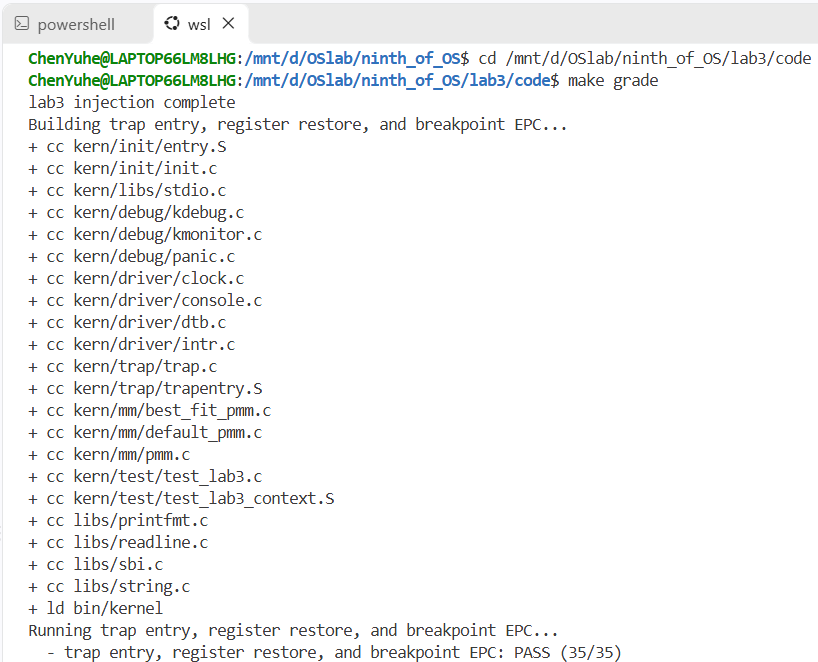
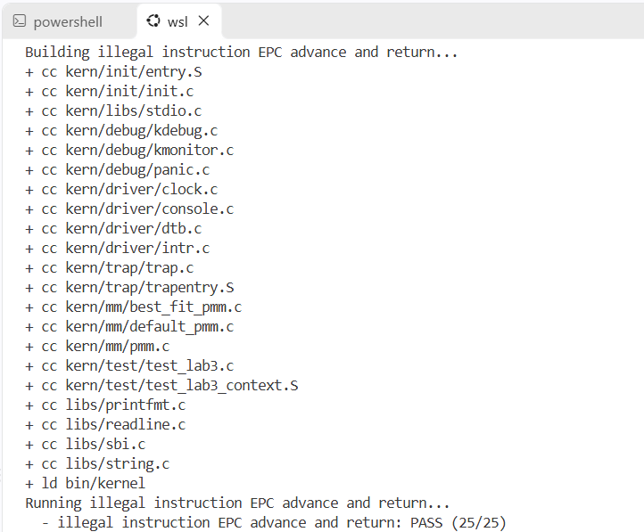
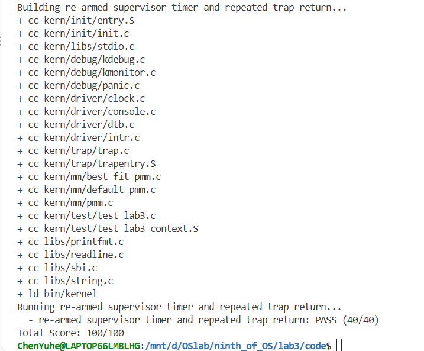
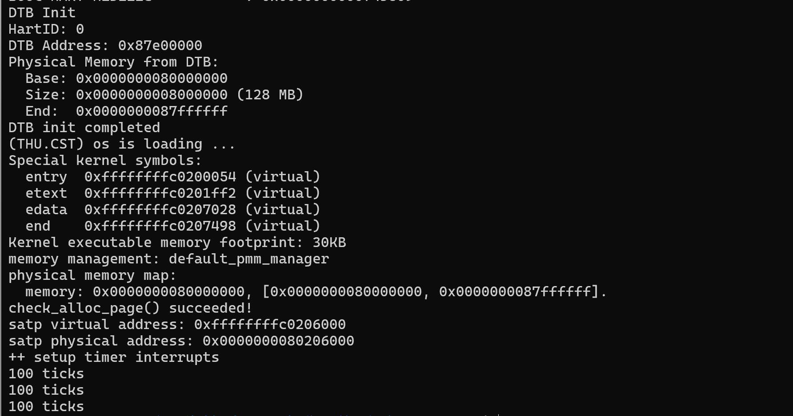

# 操作系统实验报告

## 实验基本信息

| 项目 | 内容 |
| --- | --- |
| **实验名称** | Lab 3: 中断处理机制 |
| **小组成员** | 2413094-卢思齐、2414113-焦程远、2411617-陈彦冰 |
| **完成日期** | 2026-11-02 |

### 小组分工

| 成员 | 负责的练习/模块 |
| --- | --- |
| 2413094-卢思齐 | 模块一<Trap 上下文恢复与 Trap 入口功能> |
| 2411617-陈彦冰 | 模块一<Trap 上下文恢复与 Trap 入口功能> |
| 2414113-焦程远 | 模块二<中断与异常处理功能> |

***

## 一、实验目的

本实验的主要目的是：

1. 理解RISC-V架构下的中断与异常处理机制
2. 掌握中断前后上下文的保存与恢复

***

## 二、实验环境

| 成员 | AI 编程工具 | 底层模型 | 备注 |
| --- | --- | --- | --- |
| 2413094-卢思齐 | Copilot（VS Code插件） | DeepSeek-V4-pro | 自定义Agent |
| 2411617-陈彦冰 | Claude Code（VS Code插件） | DeepSeek-Flash |  |
| 2414113-焦程远 | Copilot（VS Code插件） | DeepSeek-V4-pro | 自定义Agent |

**说明：**

- **AI 编程工具**：指具体使用的终端工具、编辑器插件、桌面应用或浏览器界面
- **底层模型**：指该工具使用的大语言模型及版本

***

## 三、实验整体逻辑分析

### 2.1 本章节的逻辑主线

- 本章围绕哪个核心主题展开？

    - 本章围绕RISC-V架构下的中断与异常处理机制（Trap 机制）展开。操作系统作为计算机系统的监管者，必须具备响应外设请求、时钟脉冲或程序异常一类的突发事件的能力。

- 整个实验解决什么问题？

    - 整个实验解决了“内核如何安全地暂停当前执行流、保存现场、进入特定处理程序，并在处理完成后完美恢复现场继续执行”的问题。具体来说，就是通过软硬件配合，建立从汇编层的上下文保存/恢复，到 C 语言层的Trap类型分发，再到具体中断和异常业务处理的完整闭环。

### 2.2 功能的逐步实现

1. 首先实现功能模块一：Trap 上下文恢复与入口功能

    - 这是处理一切Trap的物理基础。在`SAVE_ALL`已提供的前提下，必须先通过 `__alltraps`将栈上的`Trapframe`按照RISC-V调用约定传递给 C 语言函数`trap()`，再实现`RESTORE_ALL`以便在 C 函数返回后恢复寄存器状态。打通了“能进能出”的底层汇编通道，系统发生中断时才不会直接崩溃，后续的 C 语言处理逻辑才能有执行的可能。

2. 接着再完善功能模块二：中断与异常处理功能

    - 这是让整个系统“活”起来并具备实际功能的关键。在模块一保证了控制流能正确进入和退出 C 语言函数` trap()` 后，我们需要填充真正的业务逻辑。例如，必须在时钟中断中调用 `clock_set_next_event()` 来设置下一次时钟事件，不然的话系统只会收到一次中断就死寂；需要在异常处理中根据指令长度正确更新 `tf->epc`，否则系统返回后会陷入重复执行同一条异常指令的死循环。

3. 最后进行联调，形成完整的Trap处理闭环

    - 利用时钟中断的持续触发和特定的异常，将模块一的底层上下文切换与模块二的上层处理逻辑结合起来验证。确定系统是否能在被不断打断的情况下稳定输出统计信息，并在达到特定条件（如`SHUTDOWN_AFTER`）后正确关机，成功的话即可判定最终完成整个实验的预期目标。

***

## 四、实验内容与实现

### 功能模块一：Trap 上下文恢复与 Trap 入口功能

**负责人：** 2413094-卢思齐、2411617-陈彦冰

#### 模块功能描述

**需要实现/修改的函数：**

```c
// 修改文件：kern/trap/trapentry.S

//汇编宏，用于从 Trap frame 中恢复处理器状态
.macro RESTORE_ALL
//汇编入口标签，用于保存上下文、调用 C 函数并衔接返回
__alltraps:
```

**功能说明：**

- 该模块在整个系统中的作用

    - 本模块是操作系统的底层“现场保护与恢复”枢纽以及整个 Trap 处理机制的基础。它负责在硬件产生 Trap时建立汇编层与 C 语言层之间的调用桥梁，接管了从“硬件跳转至内核入口”到“C 语言处理函数执行”之间的所有底层上下文管理，并在处理结束后安全地恢复现场，使得被打断的程序能够像什么都没发生过一样继续执行。

- 需要处理的主要场景

    1. 进入内核：当硬件跳转到 `__alltraps` 后，需保证当前的 `trapframe` 地址能够按照 RISC-V 调用约定正确传递给 C 语言的 `trap(struct trapframe *tf)` 函数，且不破坏栈帧结构。
    2. 上下文保存：依赖已有的 `SAVE_ALL` 宏，将通用寄存器和关键 CSR（如 `sstatus`、`sepc`、`scause` 等）保存到内核栈上。
    3. 恢复现场：在 `trap()` 函数返回后，通过 `RESTORE_ALL` 从内核栈上的 `trapframe` 中逆向恢复各个寄存器和 CSR。
    4. 特殊寄存器处理：处理 `x2(sp)` 的特殊性。在恢复过程中，必须最后恢复 `sp`，避免在恢复其他寄存器时丢失 `trapframe` 的基址；同时需正确恢复中断使能状态，以便 `sret` 能够正常返回。

- 与其他模块的交互关系

    1. 与硬件/体系结构的交互：严格遵守 RISC-V 的函数调用约定和特权指令（如 `csrr/csrw`、`sret`），确保特权级切换和中断状态的正确流转。
    2. 与已提供代码的交互：与 `SAVE_ALL` 保持严格对称的数据布局关系（依赖 `struct trapframe` 的内存结构），不能自行假设布局。
    3. 与模块二的交互：本模块负责“敲门”，将控制流安全交接给 C 语言的 `trap()` 及其分发函数（模块二实现的 `interrupt_handler` 和 `exception_handler`）。模块二完成业务逻辑并返回后，本模块负责“关门”，恢复现场并离开内核态。

#### 最终提示词

以下是经过迭代优化后，最终成功实现该功能的提示词：

```markdown
任务：修改文件kern/trap/trapentry.S，实现Trap上下文恢复宏RESTORE_ALL，以__alltraps 中“把Trap frame按 RISC-V调用约定传给trap()、并衔接__trapret”的汇编逻辑。目标是完成“Trap 进入→ SAVE_ALL→调用trap(struct trapframe *tf) →返回__trapret→RESTORE_ALL→ sret”的完整闭环。

操作要求：你必须在项目中修改实际文件，而不是仅展示代码。只允许在 trapentry.S中标有#lab3 function1 YOUR CODE的两处位置补全：
- .macro RESTORE_ALL与.endm之间；
- __alltraps: 标签内、SAVE_ALL之后、__trapret: 之前。
必须保留SAVE_ALL、__trapret 骨架、sret以及文件中其他现有代码不变。不要修改SAVE_ALL，不要修改struct trapframe的布局，不要修改trap()的函数签名，不要在RESTORE_ALL中执行sret（sret由__trapret统一执行）。

输出要求：直接进行文件操作，使下面[RELY]、[GUARANTEE]、[SPECIFICATION] 中的信息。所有汇编宏、CSR 名、寄存器别名、STORE/LOAD 定义必须以项目真实的riscv.h 和 trapentry.S为准，不要引入与工程无关的宏或函数。

[RELY]
//工程真实宏定义（来自libs/riscv.h，rv64分支）
// __riscv_xlen == 64 时：
// #define STORE    sd
// #define LOAD     ld
// #define LOG_REGBYTES 3
// #define REGBYTES (1 << LOG_REGBYTES)   // 即 8
// 因此 REGBYTES == 8，STORE == sd，LOAD == ld。
// .S 文件经cpp预处理，上述宏可直接使用。
//GAS支持csrr/csrw/csrrw伪指令；csr名称sstatus/sepc/sbadaddr/scause/sscratch均可用
// （sbadaddr 已在现有 SAVE_ALL 中使用，工具链接受）。
// call伪指令可用（-mcmodel=medany，auipc+jalr范围足够）。

// Trap frame 数据结构（来自kern/trap/trap.h，不得修改）
struct pushregs {
    uintptr_t zero;  // x0
    uintptr_t ra;    // x1
    uintptr_t sp;    // x2
    uintptr_t gp;    // x3
    uintptr_t tp;    // x4
    uintptr_t t0;    // x5
    uintptr_t t1;    // x6
    uintptr_t t2;    // x7
    uintptr_t s0;    // x8
    uintptr_t s1;    // x9
    uintptr_t a0;    // x10
    uintptr_t a1;    // x11
    uintptr_t a2;    // x12
    uintptr_t a3;    // x13
    uintptr_t a4;    // x14
    uintptr_t a5;    // x15
    uintptr_t a6;    // x16
    uintptr_t a7;    // x17
    uintptr_t s2;    // x18
    uintptr_t s3;    // x19
    uintptr_t s4;    // x20
    uintptr_t s5;    // x21
    uintptr_t s6;    // x22
    uintptr_t s7;    // x23
    uintptr_t s8;    // x24
    uintptr_t s9;    // x25
    uintptr_t s10;   // x26
    uintptr_t s11;   // x27
    uintptr_t t3;    // x28
    uintptr_t t4;    // x29
    uintptr_t t5;    // x30
    uintptr_t t6;    // x31
};

struct trapframe {
    struct pushregs gpr;   // 偏移 0*REGBYTES ~ 31*REGBYTES
    uintptr_t status;      // 偏移 32*REGBYTES
    uintptr_t epc;         // 偏移 33*REGBYTES
    uintptr_t badvaddr;    // 偏移 34*REGBYTES
    uintptr_t cause;       // 偏移 35*REGBYTES
};

//已有的 SAVE_ALL（不得修改，RESTORE_ALL必须与之严格对称）
    .macro SAVE_ALL
    csrw sscratch, sp

    addi sp, sp, -36 * REGBYTES
    # save x registers
    STORE x0, 0*REGBYTES(sp)
    STORE x1, 1*REGBYTES(sp)
    STORE x3, 3*REGBYTES(sp)
    STORE x4, 4*REGBYTES(sp)
    STORE x5, 5*REGBYTES(sp)
    STORE x6, 6*REGBYTES(sp)
    STORE x7, 7*REGBYTES(sp)
    STORE x8, 8*REGBYTES(sp)
    STORE x9, 9*REGBYTES(sp)
    STORE x10, 10*REGBYTES(sp)
    STORE x11, 11*REGBYTES(sp)
    STORE x12, 12*REGBYTES(sp)
    STORE x13, 13*REGBYTES(sp)
    STORE x14, 14*REGBYTES(sp)
    STORE x15, 15*REGBYTES(sp)
    STORE x16, 16*REGBYTES(sp)
    STORE x17, 17*REGBYTES(sp)
    STORE x18, 18*REGBYTES(sp)
    STORE x19, 19*REGBYTES(sp)
    STORE x20, 20*REGBYTES(sp)
    STORE x21, 21*REGBYTES(sp)
    STORE x22, 22*REGBYTES(sp)
    STORE x23, 23*REGBYTES(sp)
    STORE x24, 24*REGBYTES(sp)
    STORE x25, 25*REGBYTES(sp)
    STORE x26, 26*REGBYTES(sp)
    STORE x27, 27*REGBYTES(sp)
    STORE x28, 28*REGBYTES(sp)
    STORE x29, 29*REGBYTES(sp)
    STORE x30, 30*REGBYTES(sp)
    STORE x31, 31*REGBYTES(sp)

    # get sr, epc, badvaddr, cause
    csrrw s0, sscratch, x0
    csrr s1, sstatus
    csrr s2, sepc
    csrr s3, sbadaddr
    csrr s4, scause

    STORE s0, 2*REGBYTES(sp)     // 保存 Trap 发生前的原 sp
    STORE s1, 32*REGBYTES(sp)    // sstatus
    STORE s2, 33*REGBYTES(sp)    // sepc
    STORE s3, 34*REGBYTES(sp)    // sbadaddr
    STORE s4, 35*REGBYTES(sp)    // scause
    .endm

//关键布局说明（必须据此实现RESTORE_ALL）：
// -偏移0*REGBYTES保存 x0，恒为0，无需恢复。
// -偏移1*REGBYTES ~ 31*REGBYTES依次保存x1~x31的原始值。
// -偏移2*REGBYTES保存的是Trap发生前的原sp（由csrrw s0, sscratch, x0得到），
//不是当前trapframe基址，也不是SAVE_ALL执行到一半时的sp。
// -偏移8*REGBYTES保存的是原s0（x8的值，与偏移2*REGBYTES不是同一个东西。
// -偏移32/33/34/35*REGBYTES依次保存sstatus/sepc/sbadaddr/scause。
// -SAVE_ALL中csrrw s0, sscratch, x0之后sscratch变为0；Trap处理期间 sscratch 保持0，
//RESTORE_ALL不需要恢复sscratch。

//已有骨架（不得修改__trapret 中的sret和结构）
    .macro RESTORE_ALL
    #lab3 function1 YOUR CODE
    .endm

    .globl __alltraps
    .align(2)
__alltraps:
    SAVE_ALL
    #lab3 function1 YOUR CODE
    # sp should be the same as before "jal trap"

    .globl __trapret
__trapret:
    RESTORE_ALL
    # return from supervisor call
    sret

// C 侧接口（不得修改签名）
void trap(struct trapframe *tf);

//体系结构约定
// -RISC-V调用约定：第一个参数放a0；trap为普通C函数，遵守ABI。
// - sret使用sepc作为返回地址、sstatus 决定特权级与中断使能。
// - idt_init中已将sscratch写0；SAVE_ALL中再次清零。RESTORE_ALL不恢复sscratch。
// - sstatus、sepc必须恢复；sbadaddr、scause按SAVE_ALL对称恢复（工具链接受csrw这两个CSR）。
// - 恢复sp必须放在最后一步；LOAD sp, 2*REGBYTES(sp)是合法指令：地址计算使用旧sp，
//加载后sp变为原sp。执行该指令后不得再通过sp访问trapframe。
// -调用C函数可用call trap；返回后控制流应进入__trapret。

[GUARANTEE]

必须实现或修改的汇编单元：
.macro RESTORE_ALL
    //实现上下文恢复
.endm

__alltraps:
    SAVE_ALL
    //实现trapframe到trap()的参数传递，并衔接__trapret

约束：
-不得新增或修改SAVE_ALL、__trapret、sret。
-不得修改struct trapframe布局与trap()签名。
-不得在RESTORE_ALL中执行sret。
-允许在RESTORE_ALL和__alltraps中使用通用寄存器和现有宏（REGBYTES、STORE、LOAD、csrr/csrw/csrrw等）。
-不要求引入辅助宏；若引入，必须是文件内局部宏，不影响SAVE_ALL与外部接口。

[SPECIFICATION]

## RESTORE_ALL
Pre-Condition:
- sp指向一个由SAVE_ALL建立的trapframe，布局严格为：偏移0~31依次保存 x0~x31（其中偏移2*REGBYTES保存Trap发生前的原sp，偏移8*REGBYTES保存原s0），偏移32保存sstatus，偏移33保存sepc，偏移34保存sbadaddr，偏移35保存scause。
- sscratch为 0。
- 控制流位于__trapret中，RESTORE_ALL执行完后将执行sret。

Post-Condition:
-所有通用寄存器x1~x31恢复为trapframe中对应偏移保存的值；x0恒为0，无需恢复。
- sstatus、sepc恢复为trapframe中对应字段保存的值；sbadaddr、scause按SAVE_ALL对称恢复。
- sp恢复为trapframe偏移 2*REGBYTES处保存的原sp值。
- sscratch保持0。
- RESTORE_ALL不执行sret；执行完后控制流继续到__trapret的sret，由sret使用恢复后的sepc/sstatus完成Trap返回。

  Case 1（正常恢复路径）:
  -触发条件：__trapret 被进入，sp指向有效trapframe。
  -执行行为：按照与SAVE_ALL严格对称的关系，从trapframe恢复sstatus/sepc/sbadaddr/scause和全部通用寄存器，并最终恢复sp。
  -最终状态：处理器执行状态与Trap发生时一致（sscratch保持0），sret可正确返回原执行流。

Requirements:
-必须与SAVE_ALL的保存布局严格对称，不得假设SAVE_ALL之外的布局。
-恢复x8(s0)必须从偏移8*REGBYTES加载，不能从偏移2*REGBYTES加载；偏移2*REGBYTES只用于恢复sp。
-恢复sp必须是最后一步。允许使用LOAD sp, 2*REGBYTES(sp)；该指令在计算地址时使用旧sp，是合法的。执行后不得再通过sp访问trapframe。
-恢复CSR时可使用临时寄存器（如t0），但该临时寄存器最终必须从trapframe 恢复其原始值。
-恢复过程中使用的任何临时寄存器，都不得在恢复其原始值之前被用于其他会破坏最终状态的用途；最终所有x1~x31必须等于trapframe中对应偏移的值。
-恢复sstatus必须保证sret使用正确的返回状态。
-不得执行sret。
-汇编语法、宏名、CSR名必须与项目riscv.h和工具链一致。

## __alltraps（SAVE_ALL之后的部分）
Pre-Condition:
- Trap已发生，硬件跳转到stvec指向的__alltraps。
- SAVE_ALL已执行完毕，sp指向新建的trapframe，trapframe内容有效。

Post-Condition:
- 当前trapframe的地址已按RISC-V调用约定放入a0。
- 已调用void trap(struct trapframe *tf)。
- trap返回后，sp仍指向同一个trapframe起始地址（trap作为C函数遵守ABI，返回后调用者的sp不变）。
- 控制流进入__trapret。

  Case 1（正常 Trap 进入路径）:
  -触发条件：任意 Trap 进入__alltraps 并完成SAVE_ALL。
  -执行行为：把当前sp（即trapframe起始地址）放入a0，调用trap，返回后进入__trapret。
  -最终状态：trapframe未被破坏，sp指向trapframe，准备执行RESTORE_ALL。

Requirements:
-不得修改SAVE_ALL、trap() 签名、__trapret骨架。
-调用trap时不得破坏trapframe；trap返回后sp必须仍指向trapframe起始地址，以便__trapret中的RESTORE_ALL使用。
-不得跳过__trapret 直接sret。
- ra会在调用trap时被覆盖，但ra的原值已在trapframe中保存，由RESTORE_ALL恢复，因此无需在__alltraps 中额外保存ra。
-使用call trap或等效的auipc + jalr调用；返回后进入__trapret。

```

#### 实现迭代过程

本模块的实现经历了 1 次迭代，过程如下：

***

##### 第一次迭代

AI直接生成正确代码，人工审查无误

**最终结果：**

经过 1 次迭代，该模块最终：

- ✅ 编译通过，成功补全了 `RESTORE_ALL` 与 `__alltraps` 汇编代码，与 C 语言接口正常链接。
- ✅ 所有相关测试通过，在 `make grade` 中，上下文恢复、断点、非法指令及时钟中断测试均满分通过。
- ✅ 功能符合预期，严格对齐 `SAVE_ALL` 完成寄存器恢复，正确处理了 `sp` 最后恢复的特殊性，并成功传递参数给 `trap()` 实现闭环返回。

***

### 功能模块二：中断与异常处理功能

**负责人：** 2414113-焦程远

#### 模块功能描述

**需要实现/修改的函数：**

```c
// 修改文件：kern/trap/trap.c
void interrupt_handler(struct trapframe *tf);   // 中断分类处理
void exception_handler(struct trapframe *tf);   // 异常分类处理

// 修改文件：kern/trap/trap.h
// 补充上述两个函数的声明
```

**功能说明：**

- 该模块在整个系统中的作用

    - 本模块是 Trap 处理机制的“业务核心”。模块一负责把 Trap 现场保存进 `trapframe` 并交给 C 语言层，而本模块则依据 `scause` 的值对这些 Trap 进行具体分类与处理：对时钟中断完成重武装、计数、统计与关机，对软中断进行类型提示，对非法指令与断点异常按指令长度更新执行位置，对无法识别的中断/异常输出完整现场信息辅助调试。

- 需要处理的主要场景

    1. 时钟中断（`IRQ_S_TIMER`）：调用 `clock_set_next_event()` 设置下一次时钟事件，保证时钟中断能够持续产生；每收到一次中断将 `ticks` 加一；当 `ticks` 达到 `TICK_NUM` 的整数倍时输出规定格式的统计信息；累计输出达到 `SHUTDOWN_AFTER` 次后调用 SBI 关机接口结束系统。
    2. 软中断（`IRQ_S_SOFT`）：完成基本的类型区分并输出对应提示。
    3. 未知中断：输出 `Unknown interrupt: cause ...` 提示，并调用 `print_trapframe(tf)` 打印完整 Trap frame 辅助调试。
    4. 非法指令异常（`CAUSE_ILLEGAL_INSTRUCTION`）：按规定格式输出，并依据指令长度正确推进 `tf->epc`，保证 Trap 返回后不会重复执行已经触发异常的指令。
    5. 断点异常（`CAUSE_BREAKPOINT`）：按规定格式输出，同样依据指令长度推进 `tf->epc`。
    6. 其他异常：调用 `print_trapframe(tf)` 输出完整现场辅助调试。

- 与其他模块的交互关系

    1. 与模块一的交互：模块一的 `__alltraps` 将 `trapframe` 传入 `trap()`，`trap_dispatch()` 依据 `cause` 最高位（Interrupt 位）把控制流分发给本模块的 `interrupt_handler` / `exception_handler`；处理完成后控制流返回到统一的 Trap 返回流程，由模块一的 `RESTORE_ALL` 与 `sret` 恢复现场。
    2. 与时钟驱动的交互：调用 `clock_set_next_event()` 重新武装下一次时钟事件，并读写全局计数 `ticks`。
    3. 与 SBI 的交互：达到规定条件后调用 `libs/sbi.h` 提供的 `sbi_shutdown()` 执行系统关机。

#### 最终提示词

以下是经过迭代优化后，最终成功实现该功能的提示词：

```markdown
[PROMPT]
需要完成中断与异常处理功能部分，对 Trap 入口传递过来的中断和异常进行具体分类和处理。

[RELY]
struct trapframe、trap_dispatch()、interrupt_handler()、exception_handler()、print_trapframe()、clock_set_next_event()、ticks、TICK_NUM、SHUTDOWN_AFTER、IRQ_S_TIMER、CAUSE_ILLEGAL_INSTRUCTION、CAUSE_BREAKPOINT 以及 libs/sbi.h 中提供的关机相关接口。

[GUARANTEE]
interrupt_handler() 接收当前 Trap frame，根据 Trap 原因处理中断，并返回到统一的 Trap 返回流程；
IRQ_S_TIMER 必须能持续产生时钟中断，在一定条件下输出统计信息和执行系统关机
exception_handler() 接收当前 Trap frame，根据 tf->cause 区分非法指令异常、断点异常以及其他异常，并完成规定的输出和执行位置更新。
需要保持“Trap 类型识别、处理行为、执行位置更新、后续 Trap 返回”之间的一致性。
时钟中断不能只进行计数而不设置时钟事件，ticks 每收到一次时钟中断必须增加一次，并且当其达到 TICK_NUM 的整数倍时输出规定格式的统计信息；
不能假定所有异常使用相同的 epc 偏移量（因为不同异常对应的指令长度可能不同）
整个模块不得修改函数签名，也不得修改 trap.c 中规定以外的其他函数。

[SPECIFICATION]
interrupt_handler() 负责处理中断，其中时钟中断需要完成下一次时钟事件设置、时钟计数、统计信息输出以及达到规定次数后的系统关机；
print_trapframe(tf) 对无法识别的中断输出完整 Trap frame 以辅助调试。
exception_handler() 负责处理实验要求的异常，对非法指令异常、断点异常，要输出符合规定格式的信息，依据指令长度正确更新 tf->epc，需要保证 Trap 返回以后不会重复执行已经触发异常的指令
```

#### 实现迭代过程

本模块的实现经历了 3 次迭代，过程如下：

***

##### 第一次迭代

AI 依据最终提示词直接生成 `interrupt_handler` 与 `exception_handler`，并补充 `trap.h` 中的函数声明。执行 `make` 时遇到编译错误。

**遇到的问题：**

- 问题1：`best_fit_pmm.c` 编译报错 `'free_list' undeclared`、`'nr_free' undeclared`——lab3 骨架中 `//lab2 请补充你在lab2中的代码` 处为空，Best-Fit 实现未填入，但 Makefile 仍会编译该文件。
- 问题2：`pmm.c` 编译报错 `implicit declaration of function 'page_init'`——骨架删除了 lab2 的 `page_init`（DTB 物理内存探测）实现，坑位留空。
- 问题3：`memlayout.h` 缺少 `PHYSICAL_MEMORY_END`、`KERNEL_BEGIN_PADDR`、`KERNEL_BEGIN_VADDR` 三个宏，导致相关代码无法编译。

**问题解决策略：**

- 以上问题均为 lab2 依赖坑位而非提示词本身缺陷，不需要修改提示词。将 lab2 交付版中的 Best-Fit 完整实现、`page_init`（基于 DTB 的内存探测与空闲页初始化）移植到 lab3 骨架对应坑位，并补齐 `memlayout.h` 的三个宏，编译通过。

***

##### 第二次迭代

编译通过后，本机 QEMU 运行内核时无任何内核输出，陷入无限 page fault。

**遇到的问题：**

- 问题1：内核启动即卡死。经 lab2 调试已定位：`entry.S` 的启动页表只有高地址映射（index 511），本机 QEMU 11 下执行 `csrw satp` 后，下一条指令仍从物理地址取指，引发无限 `exec_page_fault`。

**问题解决策略：**

- 给启动页表增加恒等映射（页表条目 index 2 与 index 511 都映射 PA 0x80000000 的 1G 大页），保证开启分页后物理地址仍可执行。

***

##### 第三次迭代

修复启动映射后，按照官方评分流程（`inject.py` 注入测试 + `DEFS+=-DGRADE_LAB3_*` 编译 + QEMU 抓取串口输出）对本机进行了等价模拟评分。

**遇到的问题：**

- 无。三个评分用例一次通过。

**最终结果：**

经过 3 次迭代，该模块最终：

- ✅ 编译通过
- ✅ 所有相关测试通过（GRADE_LAB3_CONTEXT 35/35、GRADE_LAB3_ILLEGAL 25/25、GRADE_LAB3_TIMER 40/40，总分 100/100）
- ✅ 功能符合预期

**关键改进点总结：**

1. 在 [GUARANTEE] 中明确了“不能假定所有异常使用相同的 epc 偏移量”，据此实现了 `instr_length()`：读取 `epc` 处指令的低 2 位，为 `11` 时判定为 32 位指令（偏移 4 字节），否则为 16 位压缩指令（偏移 2 字节），保证 `ebreak` 与 `c.ebreak` 均能正确跳过。
2. 在 [SPECIFICATION] 中明确了关机时机：定义 `SHUTDOWN_AFTER 3`，在第三次输出统计信息（ticks=300）后调用 `sbi_shutdown()`，确保 Test 3 在 ticks=200 打印 PASS 之后才关机。
3. 明确了未知中断与未知异常的统一调试策略：均调用 `print_trapframe(tf)` 输出完整 Trap frame（评分要求 trapframe 输出中包含 `cause 0x00000014`）。

***

## 五、测试与验证

**测试截图：**

对完成更改的代码进行make grade打分操作，结果如下：

在截图1中，该测试验证了 Trap 入口（ `__alltraps` ）与上下文恢复（`RESTORE_ALL`）的正确性。测试触发了断点异常之后成功保存并恢复了完整的寄存器状态（得分为 35/35），证明底层闭环通道已顺利打通。



在截图2中，该测试验证了非法指令异常的处理逻辑。系统成功捕获异常，并在 C 语言处理函数中正确更新了 `tf->epc`，即跳过了引发异常的指令，使系统返回后未陷入死循环，测试通过（得分为 25/25）。



在截图3中，该测试验证了时钟中断的持续触发与处理，系统能够稳定地反复进入和退出 Trap，最终结果显示各项测试全部通过，总分达到 100/100。




除自动化评测脚本外，通过`make qemu`运行系统观察到，内核在完成初始化后，成功进入时钟中断的循环处理。终端持续输出`100 ticks`的信息，证明系统能够正确处理时钟中断并重新设置下一次中断事件，且 Trap 的恢复机制能够保证内核在执行流中稳定运行，模块一与模块二实现了完美配合。



***

## 六、实验总结与收获

### 对操作系统的理解

#### 1. 本实验中的重要知识点与 OS 原理的对应及对比

**（1）Trap 上下文保存与恢复 vs. 进程上下文切换（Context Switch）**

- **含义与关系**：本实验中的 `SAVE_ALL` 和 `RESTORE_ALL` 在栈上构建和恢复了 `trapframe`。这对应 OS 原理中的“进程上下文切换”的基础步骤——现场保护与恢复。原理中，当发生中断或调度时，操作系统必须保存当前程序的寄存器状态以便日后恢复执行。
- **差异**：OS 原理中的“上下文切换”通常指进程间的切换，不仅需要保存寄存器，还需要切换页表（更新 `satp` 寄存器）、切换内核栈等；而本实验主要聚焦于同一个进程/内核态内部发生 Trap 时的状态保存与返回，重点在于跨越特权级，未涉及完整的进程调度和地址空间切换。

**（2）异步中断与同步异常 vs. 中断 (Interrupt) 与异常 (Exception)**

- **含义与关系**：本实验通过 `scause` 寄存器的最高位（Interrupt 位）来区分是外部/硬件引发的中断（如时钟中断），还是当前指令执行导致的异常（如非法指令、断点）。这完美对应了 OS 原理中对“中断（异步，与当前指令无关）”和“异常（同步，由当前指令引发）”的经典分类。
- **差异**：在通用 OS 原理中，异常往往进一步细分（如陷阱 Trap、故障 Fault、中止 Abort），并且会大篇幅讲解缺页异常（Page Fault）；而本实验仅针对简化的断点异常（Breakpoint）和非法指令异常做了具体处理。

**（3）特权级切换与 CSR 寄存器 vs. 用户态与内核态 (User/Kernel Mode)**

- **含义与关系**：实验利用 RISC-V 的 `sstatus`（记录 SPP、SPIE 状态位）、`sepc`（保存返回地址）和 `sret` 指令完成 U 态与 S 态的切换。这对应了 OS 原理中“划分用户态与内核态，保护操作系统内核不受用户程序破坏”的核心思想。
- **差异**：OS 原理通常以抽象的双模式来讲解；而本实验深入到了 RISC-V 特定的硬件寄存器层面，要求必须精准操作这些 CSR 寄存器才能完成特权级流转。

**（4）关中断实现原子操作 vs. 临界区保护 (Critical Section)**

- **含义与关系**：实验在内存管理（如 `alloc_pages`）中使用了 `local_intr_save` 和 `local_intr_restore`，通过操作 `sstatus.SIE` 位来屏蔽中断。这对应了 OS 原理中解决“并发竞争”的临界区保护机制。
- **差异**：在本实验环境下，关闭中断是最简单的互斥手段；而完整的 OS 原理中，针对多核处理器，还需要引入自旋锁（Spinlock）、信号量（Semaphore）等更复杂的并发控制机制。

***

#### 2. OS 原理中很重要，但在本实验中未对应的知识点

以下知识点在现代操作系统中极为关键，但受限Lab3的教学目标，并未直接体现：

1. **缺页异常处理与虚拟内存映射 (Page Fault & Virtual Memory)**：OS 原理中，缺页异常是懒加载、内存换出、写时复制（Copy-on-Write）的核心机制。本实验虽然有了虚拟内存，但本阶段并没有处理缺页引发的 Trap。
2. **中断的下半部机制 (Bottom Half / 软中断 / 工作队列)**：原理中，为了减少关中断的时间，硬件中断处理（上半部）通常极短，耗时的工作会推迟到下半部（如 Softirq、Tasklet）执行。本实验的时钟中断处理是直接一次性做完的，没有涉及上下半部的分离。
3. **高级调度算法与进程/线程生命周期管理**：实验虽触发了时钟中断，但 `interrupt_handler` 中仅做了简单的 `ticks` 累加，并没有基于时钟中断去实现时间片轮转、优先级调度或多任务切换。
4. **系统调用 (System Call) 的完整业务闭环**：虽然了解了 `ecall` 指令，但本实验并未真正实现一个从用户态发起、经由 `ecall` 陷入内核、分发到具体的 `syscall` 函数，最后返回用户态的完整系统调用框架。
5. **多核并发与缓存一致性 (Multi-core & Cache Coherence)**：RISC-V 支持多核（hart），现代 OS 必须处理多核间的同步（如使用原子指令 `amo` 实现自旋锁）。本实验在单核环境下进行，未涉及多核并发控制。

### AI 协作开发的经验

1. **规范提示词书写**：本次实验与AI协作中最有效的做法是把提示词当成一份契约文书来写，严谨地列举所有注意事项与使用者需求，比如，[RELY] 枚举全部可依赖的符号，避免 AI 凭空杜撰不存在的接口；[GUARANTEE] 明确行为约束与禁止事项（如“不能假定所有异常使用相同的 epc 偏移量”），直接决定了 `instr_length()` 的实现方式；[SPECIFICATION] 描述每个函数的输入输出语义。提示词写得越精确，AI 生成的代码越接近一次通过。
2. **学会让 AI 闭环迭代而不是只看代码**：在实践中我们发现仅仅让 AI 输出代码是不够的。真正暴露问题的是“生成 → 编译 → 运行 → 评分”的闭环，完成任务之后的编译阶段让我们及时发现了 lab2 依赖坑位未填，而再之后的运行阶段发现了本机环境下 QEMU 启动页表缺少恒等映射。
3. **时刻谨记环境差异要写进提示词或笔记**：官方评分脚本假设了 Linux 环境（`/tmp`、`-device loader` 启动），但本机是 Windows + QEMU 11，两者行为不同。我们在编译前一定要把这类环境约束提前告知 AI，这样我们就能避免在排查环境问题上少走很多弯路。

***
