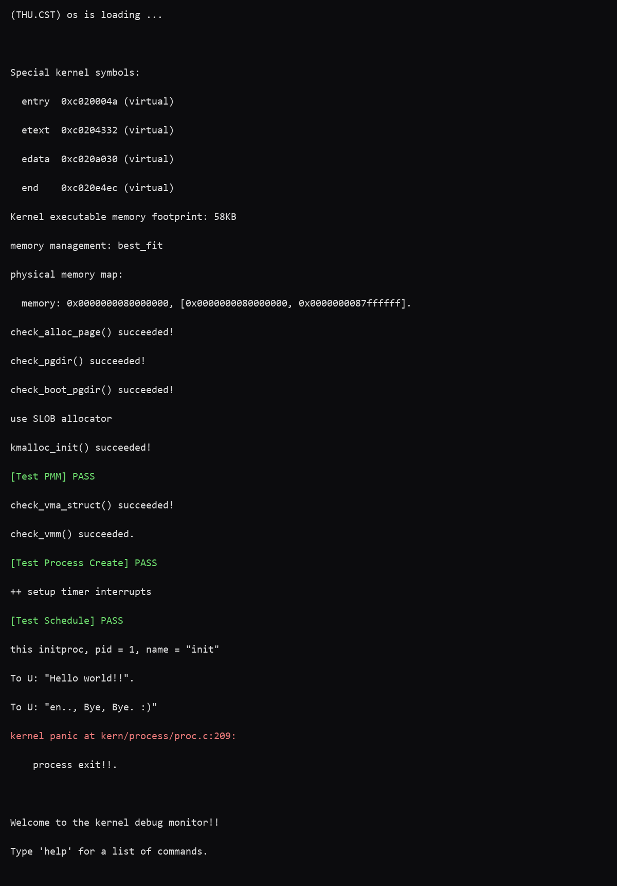

# 操作系统实验报告

## 实验基本信息

| 项目 | 内容 |
| --- | --- |
| **实验名称** | Lab 4: 进程管理 |
| **小组成员** | 2413094-卢思齐、2414113-焦程远、2411617-陈彦冰 |
| **完成日期** | YYYY-MM-DD |

### 小组分工

| 成员 | 负责的练习/模块 |
| --- | --- |
| 2413094-卢思齐 | 模块一<虚拟内存页操作功能> |
| 2411617-陈彦冰 | 模块二<进程创建及初始化功能> |
| 2414113-焦程远 | 模块三<进程调度> |

***

## 一、实验目的

本实验的主要目的是：

1. 了解虚拟内存管理的基本结构，掌握虚拟内存的组织与管理方式
2. 了解内核线程创建/执行的管理过程
3. 了解内核线程的切换和基本调度过程

***

## 二、实验环境

| 成员 | AI 编程工具 | 底层模型 | 备注 |
| --- | --- | --- | --- |
| 2413094-卢思齐 | Copilot（VS Code插件） | DeepSeek-V4-pro | 自定义Agent |
| 2411617-陈彦冰 | Claude Code（VS Code插件） | DeepSeek-Flash |  |
| 2414113-焦程远 | Copilot（VS Code插件） | DeepSeek-V4-pro | 自定义Agent |

**说明：**

- **AI 编程工具**：指具体使用的终端工具、编辑器插件、桌面应用或浏览器界面
- **底层模型**：指该工具使用的大语言模型及版本

***

## 三、实验整体逻辑分析

### 3.1 本章节的逻辑主线

- 本章围绕哪个核心主题展开？

    - 本章实验围绕“内核线程的创建、管理与调度”这一核心主题展开。它是操作系统从底层的物理/虚拟内存管理，迈向高层多任务并发控制的关键一步，涵盖了进程控制块（PCB）的设计、执行现场的构造（内核栈、中断帧、上下文）以及底层的 CPU 上下文切换机制。

- 整个实验解决什么问题？

    - 整个实验解决了“如何让操作系统内核具备多任务并发执行能力”的问题。具体而言，在具备了物理内存分配和基础页表映射能力之后，系统需要将当前正在运行的代码流（`kern_init`）包装成第 0 个线程（`idleproc`），进而通过 `fork` 机制创建出第一个真正意义上的独立内核线程（`initproc`）。最后，通过实现 `FIFO` 调度器和底层的汇编级上下文切换（`switch_to`），让 `initproc` 能够从 `idleproc` 手中真正接管 CPU 并运行起来，从而建立起完整的内核线程生命周期闭环。

### 3.2 功能的逐步实现

本章实验严格遵循“自底向上的依赖关系”和“从静态数据结构到动态控制流”的逻辑主线，逐步实现了以下功能：

1. 首先实现**虚拟内存页操作功能**

    - 建立稳定可靠的页表映射是后续一切线程内存管理的基础。线程在创建时需要分配内核栈，在切换时需要切换页表。必须先实现物理页到虚拟地址的安全映射挂载与撤销，并严格保证“页表项内容、物理页引用计数、TLB 状态”三者的同步。如果不先打通这层底层基础，后续任何涉及内存访问和地址空间隔离的线程功能都将直接崩溃。

2. 接着再完善**进程创建及初始化功能**

    - 在页表可用的基础上，内核需要将干瘪的“执行流”变成可被统一管理的“实体”。首先通过 `alloc_proc` 得到干净的 PCB，并借助 `proc_init` 将当前内核初始化现场直接包装成第 0 个线程 `idleproc`。但 `idleproc` 只是继承了现场，系统需要真正的独立线程。因此，借助 `kernel_thread` 和 `do_fork` 机制，结合 `copy_thread` 为新线程分配独立的物理页作为内核栈，并在栈上精心伪造出一套中断帧（`trapframe`）和上下文环境（`context.ra` 指向 `forkret`）。一切准备好后，我们就为新线程的“首次运行”铺平了道路。

3. 然后完成**进程调度与上下文切换功能**

    - 线程实体（`idleproc` 和 `initproc`）虽然已经就绪，但 CPU 依然被 `idleproc` 霸占。这时必须引入调度器。当 `idleproc` 执行 `cpu_idle` 并触发调度时，`schedule` 采用 FIFO 策略在队列中找到处于 `PROC_RUNNABLE` 状态的 `initproc`。随后，`proc_run` 在关中断的临界区下更新当前进程指针并切换页表基址（`lsatp`）。最后，底层的汇编函数 `switch_to` 保存旧线程的 `callee-saved` 寄存器并恢复新线程的寄存器，通过 `ra` 寄存器跳入 `forkret` 进而恢复中断帧，最终成功让 `initproc` 第一次执行其指定的函数入口。至此，系统实现了从“拥有线程对象”到“让多线程交替运行”的质变。

4. 最后过扩展挑战巩固底层机制的理解

    - 在完成了页表管理、线程创建与调度切换的完整闭环后，回过头来分析` local_intr_save/restore` 的开关中断原理，深入理解 `sv39` 等多级分页机制下 `get_pte` 函数的设计，能够帮助我们从宏观的系统架构回到微观的硬件机制，完成从“会写代码”到“懂设计思想”的认知升华。

***

## 四、实验内容与实现

### 功能模块一：虚拟内存页操作功能

**负责人：** 2413094-卢思齐

#### 模块功能描述

**需要实现/修改的函数：**

```c
//在 kern/mm/pmm.c 中实现
int page_insert(pde_t *pgdir, struct Page *page, uintptr_t la, uint32_t perm);
void page_remove(pde_t *pgdir, uintptr_t la);
```

**功能说明：**

- 该模块在整个系统中的作用

    - 该模块是操作系统虚拟内存管理的底层基石。它负责在已建好的多级页表框架上，将物理内存页挂载到指定的线性地址（建立映射），以及将已有的映射安全地撤销（解除映射）。它决定了虚拟地址最终映射到哪一块物理内存，是后续实现进程地址空间隔离、内核线程栈分配以及进程切换（加载新页表）的绝对前提。

- 需要处理的主要场景

    1. 映射建立与覆盖：目标地址未被映射时直接建立；若已映射到同一物理页，则仅更新权限位；若已映射到不同物理页，则需先解除旧映射并清理旧页引用，再建立新映射。
    2. 内存不足异常：`page_insert` 在建立映射时，若中间级页表分配失败（`get_pte` 返回 `NULL`），需安全地返回 `-E_NO_MEM`，且不能留下半完成的映射状态。
    3. 幂等性删除：`page_remove` 必须支持“目标地址无映射”的情况，此时应安静返回，不能引发系统崩溃或异常。
    4. 三者同步：所有操作必须保证“页表项内容（PTE）、物理页引用计数（ref）、TLB 状态”严格同步。更新 PTE 后必须刷新 TLB，撤销映射时若引用计数归零则需释放物理页。

- 与其他模块的交互关系

    1. 与物理内存管理（PMM）交互：依赖 `get_pte` 动态分配中间级页表页；依赖 `page_ref_inc/page_ref_dec` 维护物理页生命周期；依赖` free_page` 在引用计数归零时回收物理页。
    2. 为进程管理（Proc）提供支撑：后续进程创建（`copy_mm`）和上下文切换（`proc_run` 切换页表基址）必须依赖本模块提供正确的地址映射基础。
    3. 与硬件 MMU 交互：通过 `tlb_invalidate(pgdir, la)` 接口向 RISC-V 硬件发送 `sfence.vma` 指令，确保 CPU 能立刻感知到页表项的变更，避免使用陈旧的地址翻译缓存。

#### 最终提示词

以下是经过迭代优化后，最终成功实现该功能的提示词：

```markdown
[PROMPT]
任务：修改 kern/mm/pmm.c文件，实现虚拟内存页操作功能模块中的 page_insert 和 page_remove 函数，并修复导致 QEMU 10.2.1 运行期页错误崩溃的底层遗留 Bug。

操作要求：你必须在项目中修改实际文件，保留文件中的所有现有代码。原文件中存在的 //LAB4 function1 YOUR CODE 这一行注释你绝对不能修改、删除或覆盖这一行注释本身。你必须将 page_insert 和 page_remove 这两个函数的实现代码严格插入、追加在这一行注释的下方。
极其重要：除了实现映射函数，你必须根因修复以下两处代码：
1.修改 get_pte 函数，去除中间级非叶子 PTE 的 PTE_U 标志；
2.修改 check_pgdir 函数中的错误断言。不要试图在 page_insert 中去同步非叶子 PTE 的权限。

输出要求：直接进行文件操作，输出修改后的代码片段。使用下面 [RELY]、[GUARANTEE]、[SPECIFICATION] 部分的信息作为唯一实现依据。

[RELY]
宏定义 (来自 mmu.h)
#define PGSIZE 4096
#define PTE_V 0x001 // Valid
#define PTE_R 0x002 // Read
#define PTE_W 0x004 // Write
#define PTE_X 0x008 // Execute
#define PTE_U 0x010 // User
#define PTE_PPN_SHIFT 10

数据结构 (来自 memlayout.h)
struct Page {
    int ref;                        // page frame's reference counter
    uint_t flags;                   // flags ...
    unsigned int property;          // free block size
    list_entry_t page_link;
    list_entry_t pra_page_link;
    uintptr_t pra_vaddr;
};
typedef uintptr_t pte_t;            
typedef uintptr_t pde_t;            

可用函数 (来自 pmm.h，均为 static inline 或已实现)
pte_t *get_pte(pde_t *pgdir, uintptr_t la, bool create); // 获取la对应的pte虚拟地址。create=1且中间级页表不存在时会分配，失败返回 NULL。
static inline pte_t pte_create(uintptr_t ppn, int type); // 构造PTE，内部已包含 PTE_V
static inline struct Page *pte2page(pte_t pte);          // 由PTE提取对应的物理页结构体
static inline int page_ref_inc(struct Page *page);       // 物理页引用计数 +1
static inline int page_ref_dec(struct Page *page);       // 物理页引用计数 -1，返回减后的值
static inline int page_ref(struct Page *page);           // 获取物理页引用计数
static inline int set_page_ref(struct Page *page, int val); // 直接设置物理页引用计数
static inline uintptr_t page2pa(struct Page *page);      // 获取物理页的物理地址
static inline ppn_t page2ppn(struct Page *page);         // 获取物理页的页号
void free_page(struct Page *page);                       // 释放物理页
void tlb_invalidate(pde_t *pgdir, uintptr_t la);         // 刷新对应线性地址的 TLB 表项

需要修改的现有代码片段
1. get_pte 中分配中间级页表时的原代码：*pdep1 = pte_create(page2ppn(page), PTE_U | PTE_V); 以及 *pdep0 = pte_create(page2ppn(page), PTE_U | PTE_V);
2. check_pgdir 中的错误断言：assert(boot_pgdir_va[0] & PTE_U);

[GUARANTEE]
必须实现或修改的接口：
需插入到 //LAB4 function1 YOUR CODE 下方的函数：
int page_insert(pde_t *pgdir, struct Page *page, uintptr_t la, uint32_t perm);
void page_remove(pde_t *pgdir, uintptr_t la);

需要修复的现有函数：
pte_t *get_pte(pde_t *pgdir, uintptr_t la, bool create);
static void check_pgdir(void);

你可以根据需要添加：
辅助函数（建议设为 static，例如实现一个 static void page_remove_pte(pde_t *pgdir, uintptr_t la, pte_t *ptep)，供 page_insert 和 page_remove 共用，以降低代码冗余）

[SPECIFICATION]
## 修复 get_pte 与 check_pgdir
根据 RISC-V Sv39 规范，非叶子 PTE 的 U 位应始终为 0，否则 QEMU 10.2.1 会在 S-Mode 访问时报错。
1. get_pte 修改逻辑：在分配第一级和第二级中间页表时，使用 pte_create 构造 PTE 时只传入 PTE_V（或其他非 U 标志），严禁传入 PTE_U。
2. check_pgdir 修改逻辑：将原本的 assert(boot_pgdir_va[0] & PTE_U); 替换为 assert(!(boot_pgdir_va[0] & PTE_U));。函数中的其他断言保持原样。

## page_insert 
Pre-Condition: 
pgdir 为页表基址，page 为待映射的物理页，la 为目标线性地址，perm 为期望的权限位。该函数需要处理潜在的页表页分配（get_pte 且 create 传 1）。

Post-Condition: 
指定的线性地址 la 成功稳定映射到 page，权限位正确，物理页引用计数正确，且 TLB 保持一致。
Case 1：get_pte(pgdir, la, 1) 返回 NULL。直接返回 -E_NO_MEM，不改变物理页引用计数。
Case 2：la 已映射到同一个物理页 page。不增加物理页引用计数。直接用新的 perm 覆盖原有权限位，即 *ptep = pte_create(page2ppn(page), perm)，调用 tlb_invalidate 刷新 TLB，返回 0。
Case 3：la 已映射到另一个不同的物理页。先调用 page_remove_pte（或等效逻辑）解除原有映射：将旧物理页引用计数减 1，若为 0 则 free_page，清空 PTE。然后增加新 page 的引用计数，设置新 PTE，刷新 TLB，返回 0。
Case 4：la 此前未被映射。增加 page 引用计数，设置 PTE，刷新 TLB，返回 0。

## page_remove 
Pre-Condition: 
pgdir 为页表基址，la 为目标线性地址。不能假定 la 一定存在有效映射。

Post-Condition: 
若存在有效映射，则撤销映射并清理资源；若不存在，安静返回。
Case 1：get_pte(pgdir, la, 0) 返回 NULL，或 PTE 无效。直接返回，不报错。
Case 2：la 存在有效映射。通过 pte2page 获取物理页，引用计数减 1。若减后为 0，则 free_page 释放。将 PTE 内容清 0，调用 tlb_invalidate 刷新 TLB。

Requirements: 
1. 绝对不要通过修改 page_insert 的叶子映射逻辑来试图修复非叶子 PTE 的权限问题。
2. 确保更新叶子 PTE 后，一定调用 tlb_invalidate(pgdir, la)。
3. 保证物理页引用计数增减与页表项修改严格同步。

```

#### 实现迭代过程

本模块的实现经历了 [N] 次迭代，过程如下：

***

##### 第一次迭代

**遇到的问题：**

- 问题1：QEMU 运行期触发页错误崩溃

    - AI 根据第一版提示词正确生成了 page_insert 和 page_remove 的代码逻辑，但在 QEMU 中运行测试时，系统在 check_pgdir 或 check_boot_pgdir 阶段直接崩溃。

- 问题2：AI 修复方案引入底层逻辑冲突

    - 在向 AI 提出修补要求时，AI 根据提示词，尝试在 page_insert 中根据 perm 动态同步中间级 PTE 的 PTE_U 位。未发生编译错误，但经过代码审查发现，同一页表分支下可能同时存在不同 PTE_U 权限的叶子映射（内核与用户页共享页表分支），按单个映射调整父级位会造成权限踩踏。

**问题解决策略：**

- 针对问题1：在第一版提示词中，直接将解决问题的目标指向“根因修复”。明确要求 AI 不要试图在 page_insert 中同步中间级权限，而是修改 get_pte 函数，在创建非叶子 PTE 时移除 PTE_U 标志，只保留 PTE_V。同时，要求 AI 修正 check_pgdir 中的错误断言，改为检查非叶子 PTE 不包含 U 位。
- 针对问题2：在提示词中明确“问题背景”和“根源冲突”，并在 [RELY] 和 [SPECIFICATION] 部分严格限制 AI 的修改范围。强调“不要修改 page_insert 和 page_remove 的映射建立逻辑”，给出正确的代码片段作为参考，强制 AI 按照 RISC-V 规范进行架构级别的修正，从而彻底闭环解决此问题。

***

##### 第二次迭代（如有）

如果设计的prompt生成代码后出现问题：

**遇到的问题：**

- 问题1：问题描述、错误信息和原因分析
- 问题2：问题描述、错误信息和原因分析

**问题解决策略：**

- 针对问题1：[说明如何修改提示词]
- 针对问题2：[说明如何修改提示词]

如果没有问题：

**最终结果：**

经过 [N] 次迭代，该模块最终：

- ✅ 编译通过
- ✅ 所有相关测试通过
- ✅ 功能符合预期

**关键改进点总结（如有）：**

1. [改进点1：例如，在 [RELY] 中补充了完整的系统调用号定义]
2. [改进点2：例如，在 [SPECIFICATION] 中明确了异常处理的边界条件]
3. [改进点3：例如，增加了对用户指针合法性检查的要求]

***

##### 第三次迭代（如有）

[按照和第一次迭代相同的格式]

***

### 功能模块二：进程创建及初始化功能

**负责人：** 2411617-陈彦冰

#### 模块功能描述

**需要实现/修改的函数：**

```c
// 在 kern/process/proc.c 中实现
static struct proc_struct *alloc_proc(void);
void proc_init(void);
int kernel_thread(int (*fn)(void *), void *arg, uint32_t clone_flags);
int do_fork(uint32_t clone_flags, uintptr_t stack, struct trapframe *tf);
static void copy_thread(struct proc_struct *proc, uintptr_t esp, struct trapframe *tf);
static int copy_mm(uint32_t clone_flags, struct proc_struct *proc);
```

**功能说明：**

- 该模块在整个系统中的作用

    - 本模块是内核从“能够执行内核代码”走向“能够并发执行多个内核线程”的关键一步。在它之前，系统只有唯一的启动执行流；经过本模块之后，系统第一次具备了进程管理的基本设施：进程控制块（PCB）的分配与初始化、进程链表与 PID 哈希表、内核栈、PID 分配、线程状态管理，以及统一的线程创建接口。具体而言，proc_init 在系统启动阶段建立两个特殊线程：0 号 idleproc 直接复用当前的启动执行现场（使用 bootstack 作为内核栈，PID 为 0，置为 PROC_RUNNABLE 并设置 need_resched），1 号 initproc 则通过 kernel_thread 真正“创建”出来。同时它初始化 proc_list、hash_list、current 与 nr_process，为后续的 fork、exit、wait、调度等机制提供全局基础。alloc_proc、copy_thread、do_fork 等函数共同构成“线程从哪里来、如何登记、如何第一次运行”的完整链路，是后续实验中用户进程、系统调用与调度器工作的前提。

- 需要处理的主要场景

    1. 系统启动时的执行现场包装：proc_init 必须保证 idleproc 的字段（PID、内核栈、状态、调度标记、current 指         向）具有特殊且正确的语义，然后创建 initproc 并通过 find_proc 取回它、命名、置为可运行。
    2. 以普通函数为入口创建内核线程：kernel_thread 把入口函数 fn 与参数 arg 放入临时 trapframe（s0/s1，epc = kernel_thread_entry，状态位由 sstatus 派生并关闭中断），再转交 do_fork。
    3. 通用线程创建与失败回滚：do_fork 依次完成 PCB 分配、父子关系设置、内核栈分配、地址空间处理、首次运行现场构造；在关中断区间内分配 PID、挂入哈希表与 proc_list、递增 nr_process，最后 wakeup_proc 唤醒。任一中间步骤失败都必须按相反顺序回收（put_kstack、kfree），避免资源泄漏。
    4. 新线程首次运行现场的构造：copy_thread 把 trapframe 安放在新线程内核栈顶，设置 context.ra = forkret、context.sp = tf，从而在调度切换后经 forkret → forkrets → \__trapret → kernel_thread_entry → fn 进入用户指定的函数；函数返回后由 entry.S 调用 do_exit 收尾。
    5. 地址空间处理的占位：当前阶段尚无用户地址空间，copy_mm 只将 proc->mm 置空并返回 0，保持接口形态完整，供后续实验扩展为真正的 mm 复制/共享。

- 与其他模块的交互关系

    - init 模块：kern_init 在完成物理内存、中断、虚拟内存初始化后调用 proc_init，随后进入 cpu_idle；本模块建立的两个线程是启动流程的终点与后续调度的起点。
    - 内存管理模块：PCB 来自 kmalloc/kfree；内核栈通过 alloc_pages(KSTACKPAGE) + page2kva 获得，释放时经 kva2page + free_pages；copy_mm 与 mm_struct、页表（boot_pgdir）预留了接口；bootstack 由 entry.S 提供。
    - trap 模块：依赖 struct trapframe 的寄存器布局、\__trapret/forkrets 汇编入口以及 SSTATUS_SPP/SPIE/SIE 状态位，copy_thread 与 kernel_thread 负责填充其内容。
    - 调度模块：wakeup_proc 将线程置为 PROC_RUNNABLE，need_resched 参与调度决策；实际的 schedule/proc_run/switch_to 属于模块三，本模块只负责把线程准备成可被切换的实体。
    - 同步与基础设施：PID 分配和全局链表挂接由 local_intr_save/restore 保护；链表、字符串、哈希、断言与错误码分别来自 list.h、string.h、stdlib.h、assert.h、error.h。

#### 最终提示词

以下是经过迭代优化后，最终成功实现该功能的提示词：

```markdown
# 模块二：进程创建及初始化功能实现提示词
### Prompt任务说明

#### 1. 修改位置与标记核对

目标文件只有一个：`lab4/code/kern/process/proc.c`。

事实：该文件只有一处 `//LAB4 function2 YOUR CODE`，位于第 221 行；第 224 行是 `//LAB4 function3 YOUR CODE`；文件到第 225 行结束。六个函数全部写在第 221 行标记之后、第 224 行标记之前。

实现前必须先核对：
- 实际标记位置、数量是否与报告一致；
- 标记是否位于待实现函数体内；
- 六个函数是否确实允许集中写在该标记后。

若核对结果与报告不一致，或标记不在函数体内，**立即停止并报告**，不得移动函数定义、不得修改标记前代码、不得自行选择其他插入点。

| 函数 | 文件 | 允许写入位置 |
|---|---|---|
| `static struct proc_struct *alloc_proc(void)` | `kern/process/proc.c` | 仅 `//LAB4 function2 YOUR CODE` 后 |
| `void proc_init(void)` | 同上 | 同上 |
| `int kernel_thread(int (*fn)(void *), void *arg, uint32_t clone_flags)` | 同上 | 同上 |
| `int do_fork(uint32_t clone_flags, uintptr_t stack, struct trapframe *tf)` | 同上 | 同上 |
| `static void copy_thread(struct proc_struct *proc, uintptr_t esp, struct trapframe *tf)` | 同上 | 同上 |
| `static int copy_mm(uint32_t clone_flags, struct proc_struct *proc)` | 同上 | 同上 |

硬性要求：
- 不得移动、删除、改写 `//LAB4 function2 YOUR CODE` 和 `//LAB4 function3 YOUR CODE` 标记。
- 不得修改标记之前的已有代码：include、`proc_list`、`hash_list`、`idleproc`、`initproc`、`current`、`nr_process`、`set_proc_name`、`get_proc_name`、`get_pid`、`forkret`、`hash_proc`、`find_proc`、`setup_kstack`、`put_kstack`、`do_exit`、`init_main`。
- 不得修改任何其他文件，包括 `proc.h`、`pmm.h`、`pmm.c`、`memlayout.h`、`mmu.h`、`riscv.h`、`trap.h`、`sched.c`、`sched.h`、`switch.S`、`entry.S`、`trapentry.S`、`Makefile`、链接脚本、`test_lab4.c`、`inject.py`。
- 允许在标记后新增仅服务于本模块的内部 `static` 辅助函数，但不得新增全局符号、不得改变对外接口。
- 不得实现或修改模块三内容：`cpu_idle`、`schedule`、`proc_run`、`switch_to`。

#### 2. 功能目标

1. `alloc_proc`：从内核堆分配 PCB，并初始化为确定的“未初始化”状态。
2. `proc_init`：初始化进程管理全局结构；构造 0 号 `idleproc`；设置 `current`；通过 `kernel_thread` 建立 1 号 `initproc` 并命名为 `"init"`。
3. `kernel_thread`：把 `fn`、`arg` 包装成内核线程首次运行现场，并通过 `do_fork` 创建线程。
4. `do_fork`：完成 PCB、内核栈、mm、首次运行现场、`proc_list`/`hash_list` 挂接、唤醒和 PID 返回。
5. `copy_thread`：在新内核栈上建立 `trapframe` 与 `context`，衔接 `forkret → forkrets → __trapret → kernel_thread_entry`。
6. `copy_mm`：当前阶段为占位接口，保持完整函数形态并固定返回 `0`，不复制用户地址空间。

#### 3. 可修改 / 不可修改范围

可修改：
- 仅 `proc.c` 中 `//LAB4 function2 YOUR CODE` 之后、`//LAB4 function3 YOUR CODE` 之前的区域。
- 可在该区域新增本模块专用 `static` 辅助函数。

不可修改：
- 标记之前的所有代码；`//LAB4 function3 YOUR CODE` 及其后内容。
- 所有宏、`struct proc_struct`、`struct context`、`struct trapframe`、`struct pushregs`、`enum proc_state`。
- 所有全局变量及其初值、所有已有函数签名与接口、lab2/lab3 已完成代码。
- 错误码约定、进程状态宏、`SSTATUS_*`、`CLONE_*`、`kernel_thread_entry`、`forkret`、`forkrets`、`__trapret` 的定义。
- 模块三函数。

#### 4. 输出验证要求

1. 不引入新的编译错误；使用工程既有 Makefile 可编译到本模块为止。
2. 若构建因与本模块无关的既有问题失败（如 `default_pmm.c` 引用的 `best_fit_pmm.h` 不存在、`default_pmm_manager` 未定义），实现 AI 必须报告该事实，不得修改其他文件绕过。
3. `tools/test_lab4.c:68` 的 `test_lab4_thread` 返回 `void`，与 `kernel_thread` 的 `int (*)(void *)` 不严格匹配；这是测试文件的既有情况，`-Wall` 只告警、无 `-Werror`，不得修改测试文件或改签名来消除告警。
4. 可观察验证点逐项成立：
   - `proc_init` 返回后：`idleproc != NULL && idleproc->pid == 0 && idleproc->state == PROC_RUNNABLE && idleproc->kstack == (uintptr_t)bootstack`。
   - `proc_init` 返回后：`current == idleproc`。
   - `idleproc->parent == NULL`、`idleproc->mm == NULL`、`idleproc->tf == NULL`、`idleproc->runs == 0`、`idleproc->flags == 0`、`idleproc->context.ra == 0`。
   - `initproc != NULL && initproc->pid == 1 && initproc->state == PROC_RUNNABLE`。
   - `initproc->parent == idleproc`、`initproc->mm == NULL`、`initproc->context.ra != 0`、`initproc->context.sp != 0`。
   - `initproc` 名称为 `"init"`，评分期望输出 `this initproc, pid = 1, name = "init"`。
   - `kernel_thread(...)` 成功返回值 `> 0`；连续创建两个线程均 `> 0`。
   - `do_fork` 成功后 `find_proc(pid)` 能找到 PCB，且该 PCB 同时位于 `proc_list` 与对应 `hash_list` 桶。
   - `copy_thread` 后 `proc->tf` 指向新内核栈内完整 `trapframe`，`proc->context.ra` 指向 `forkret`，`proc->context.sp` 指向该 `trapframe`，均非零。
5. 每条失败路径必须给出可检查的返回值、清理动作和状态不变式，不得只写“正确处理边界情况”。

---

### Rely依赖说明

只列模块二真正需要的最小依赖。模块三的 `cpu_idle`、`schedule`、`proc_run`、`switch_to` 不是本模块依赖，禁止实现、调用或写入。

#### 1. 数据结构

| 依赖 | 定义位置 | 关键内容/用途 |
|---|---|---|
| `enum proc_state` | `kern/process/proc.h:10-16` | `PROC_UNINIT=0`、`PROC_SLEEPING=1`、`PROC_RUNNABLE=2`、`PROC_ZOMBIE=3` |
| `struct context` | `kern/process/proc.h:18-34` | 字段顺序固定：`ra, sp, s0..s11`，共 14 个 `uintptr_t` |
| `struct proc_struct` | `kern/process/proc.h:42-58` | 字段：`state, pid, runs, kstack, need_resched, parent, mm, context, tf, pgdir, flags, name[16], list_link, hash_link` |
| `struct pushregs` | `kern/trap/trap.h:6-40` | 32 个 `uintptr_t`，顺序：`zero, ra, sp, gp, tp, t0, t1, t2, s0, s1, a0..a7, s2..s11, t3..t6` |
| `struct trapframe` | `kern/trap/trap.h:42-49` | `gpr` 后依次 `status`、`epc`、`badvaddr`、`cause`；RV64 下总大小 288 字节 |
| `struct mm_struct` | `kern/mm/vmm.h:30-36` | 本模块仅需知道 `mm` 字段类型，不操作内部 |
| `list_entry_t` | `libs/list.h:17-21` | 双向链表节点 |

`trapframe` 布局硬约束（来自 `kern/trap/trapentry.S:4-52,55-102,120-124`）：
- `gpr.ra` 在 `1*REGBYTES`，`gpr.sp` 在 `2*REGBYTES`，`gpr.s0` 在 `8*REGBYTES`，`gpr.s1` 在 `9*REGBYTES`；
- `status` 在 `32*REGBYTES`，`epc` 在 `33*REGBYTES`；
- `REGBYTES = 8`（RV64）。

#### 2. 全局变量与内部符号（均定义在标记前）

| 依赖 | 位置 | 类型/初值 | 用途 |
|---|---|---|---|
| `proc_list` | `proc.c:62` | `list_entry_t`，BSS 全零，未 `list_init` | 进程总链表；`get_pid` 依赖 |
| `HASH_SHIFT` / `HASH_LIST_SIZE` | `proc.c:64-65` | `10` / `1024` | 哈希桶数量 |
| `pid_hashfn(x)` | `proc.c:66` | `hash32(x, HASH_SHIFT)` | PID → 桶下标 |
| `hash_list[]` | `proc.c:69` | `static list_entry_t[1024]`，BSS 全零，各桶未 `list_init` | `hash_proc`/`find_proc` |
| `idleproc` | `proc.c:72` | `NULL` | 0 号进程 |
| `initproc` | `proc.c:74` | `NULL` | 1 号进程 |
| `current` | `proc.c:76` | `NULL` | 当前进程 |
| `nr_process` | `proc.c:78` | `static int = 0` | 进程计数，仅本文件内访问 |

#### 3. 已有函数（只允许调用，不允许修改）

| 函数 | 签名 | 位置 | 返回/错误码约定 | 本模块用途 |
|---|---|---|---|---|
| `kmalloc` | `void *kmalloc(size_t n)` | `kern/mm/kmalloc.c:260-264` | 失败返回 `NULL`；内部已处理中断 | `alloc_proc` |
| `kfree` | `void kfree(void *objp)` | `kern/mm/kmalloc.c:266-294` | 无；`NULL` 安全 | 失败清理 |
| `memset` | `void *memset(void *s, char c, size_t n)` | `libs/string.h:19` | 返回 `s` | PCB/trapframe 清零 |
| `set_proc_name` | `char *set_proc_name(struct proc_struct *, const char *)` | `proc.c:84-90` | 返回 `proc->name`；先清零再复制 `PROC_NAME_LEN` 字节 | 命名 `"idle"`、`"init"` |
| `get_pid` | `static int get_pid(void)` | `proc.c:101-142` | 总是返回 PID，无失败路径；首次调用返回 1 | `do_fork` |
| `hash_proc` | `static void hash_proc(struct proc_struct *)` | `proc.c:155-159` | 无；要求目标桶已 `list_init` | 挂入 hash 桶 |
| `find_proc` | `struct proc_struct *find_proc(int pid)` | `proc.c:162-178` | 找到返回指针，否则 `NULL`；仅接受 `0 < pid < MAX_PID` | `proc_init` 由 pid 找回 `initproc` |
| `setup_kstack` | `static int setup_kstack(struct proc_struct *)` | `proc.c:182-192` | 成功 `0`，失败 `-E_NO_MEM`；分配 `KSTACKPAGE` 页 | `do_fork` |
| `put_kstack` | `static void put_kstack(struct proc_struct *)` | `proc.c:194-199` | 无；释放 `KSTACKPAGE` 页 | 失败清理 |
| `wakeup_proc` | `void wakeup_proc(struct proc_struct *)` | `kern/schedule/sched.c:7-11` | 无；内部断言 `state != PROC_ZOMBIE && state != PROC_RUNNABLE`，随后置 `PROC_RUNNABLE` | `do_fork` 唤醒子进程 |
| `forkret` | `static void forkret(void)` | `proc.c:148-152` | 无；调用 `forkrets(current->tf)` | `copy_thread` 设置 `context.ra` |
| `init_main` | `static int init_main(void *arg)` | `proc.c:212-219` | 返回 `int` | `proc_init` 传给 `kernel_thread` |
| `local_intr_save` / `local_intr_restore` | 宏 | `kern/sync/sync.h:22-26` | 保存/恢复 `sstatus.SIE` | `do_fork` 临界区 |
| `assert` | 宏 | `kern/debug/assert.h:15-20` | 失败 `panic` | 不变量检查 |
| `panic` | 宏 | `kern/debug/assert.h:12-13` | 不返回 | 启动期不可恢复错误 |
| `cprintf` | `int cprintf(const char *fmt, ...)` | `libs/stdio.h:8` | 返回字符数 | 可选日志，保持现有风格 |

链表操作（`libs/list.h`，均无返回值）：`list_init` `:40-43`、`list_add` `:53-56`、`list_add_before` `:66-69`、`list_del` `:91-94`、`list_del_init` `:102-106`、`list_empty` `:112-115`、`list_next`/`list_prev` `:121-133`。

#### 4. 宏与常量

| 依赖 | 值 | 位置 | 用途 |
|---|---|---|---|
| `PROC_UNINIT` | 0 | `proc.h:12` | `alloc_proc` 初始状态 |
| `PROC_RUNNABLE` | 2 | `proc.h:14` | idleproc/initproc 可运行状态 |
| `PROC_NAME_LEN` | 15 | `proc.h:36` | 名称长度 |
| `MAX_PROCESS` | 4096 | `proc.h:37` | 现有上限；本模块不新增检查 |
| `MAX_PID` | 8192 | `proc.h:38` | `get_pid`/`find_proc` 内部使用 |
| `KSTACKPAGE` | 2 | `memlayout.h:44` | 内核栈页数 |
| `KSTACKSIZE` | 8192 | `memlayout.h:45` | 内核栈字节数 |
| `PGSIZE` | 4096 | `mmu.h:51` | 如需要栈顶对齐时使用 |
| `CLONE_VM` | `0x00000100` | `pmm.h:11` | `copy_mm` 判定；以报告为准，不得修改定义 |
| `CLONE_THREAD` | `0x00000200` | `pmm.h:12` | `kernel_thread`/`do_fork` 判定；以报告为准 |
| `SSTATUS_SIE` | `0x00000002` | `riscv.h:46` | 首次运行 `status` 需清除 |
| `SSTATUS_SPIE` | `0x00000020` | `riscv.h:48` | 首次运行 `status` 需设置 |
| `SSTATUS_SPP` | `0x00000100` | `riscv.h:49` | 首次运行 `status` 需设置 |
| `E_NO_MEM` | 4 | `error.h:8` | 内存不足错误码 |
| `E_INVAL` | 3 | `error.h:7` | 参数非法错误码（仅在明确需要时使用） |
| `bootstack` | `char[]` | 定义 `kern/init/entry.S:47-51`；声明 `pmm.h:180` | `idleproc->kstack` 必须等于它 |

CSR 宏（`libs/riscv.h`）：`read_csr` `:210-212`、`write_csr` `:214`、`set_csr` `:220-222`、`clear_csr` `:224-226`。

#### 5. 只读汇编符号

| 符号 | 位置 | 事实 |
|---|---|---|
| `kernel_thread_entry` | `kern/process/entry.S:2-7` | `move a0, s1; jalr s0; jal do_exit`。契约：`s0 = fn`，`s1 = arg`，参数经 `a0` 传入，返回后 `do_exit` |
| `forkret` | `proc.c:148-152` | 调用 `forkrets(current->tf)` |
| `forkrets` | `kern/trap/trapentry.S:120-124` | `move sp, a0; j __trapret` |
| `__trapret` | `kern/trap/trapentry.S:114-118` | `RESTORE_ALL` 后 `sret` |

首次运行链（仅用于约束 `copy_thread`）：
`switch_to(模块三)` → 恢复 `context.ra/sp` → `forkret` → `forkrets(current->tf)` → `__trapret` → `sret` → `tf->epc`。

#### 6. 实现前需确认的显式假设

以下按显式假设实现，并在交付说明中列明；不得臆造为既有事实。

- **A1（`proc_init` 失败处理）**：`alloc_proc` 或 `kernel_thread` 失败时使用 `panic(...)` 终止启动。若教学参考另有约定，先停止并报告，不得静默选择其他行为。
- **A2（`idleproc->need_resched`）**：置 `1` 以配合后续首轮调度；测试未断言该字段。若不置，交付说明写明。
- **A3（`idleproc` 是否入 hash）**：`idleproc` 必须挂入 `proc_list` 并递增 `nr_process`；`hash_proc(idleproc)` 可选，测试不依赖。注意 `find_proc` 只接受 `0 < pid < MAX_PID`，因此 `hash_proc(idleproc)` 不会使 `find_proc(0)` 可用；不得声称 `find_proc(0)` 可查询。
- **A4（中断保护，必须）**：`proc_init` 在 `intr_enable` 之前执行，无需额外锁；但 `do_fork` 还可能从 `init_main`/`test_lab4_schedule` 在中断开启后调用。`get_pid()`、`hash_proc()`、`list_add()`、`nr_process++` 必须放在 `local_intr_save/restore` 保护的同一个临界区内；`kmalloc`/`alloc_pages`/`free_pages` 的内部保护不覆盖这段。`wakeup_proc` 必须在挂接完成后调用。
- **A5（`kernel_thread` 的 `status`）**：首次运行 `tf.status` 必须使 `sret` 返回 S 态且返回后开中断，即设置 `SPP` 与 `SPIE`、清除 `SIE`；可基于当前 `sstatus` 或等价常量构造。
- **A6（`stack`/`esp` 语义）**：`kernel_thread` 向 `do_fork` 传入 `stack = 0`；`copy_thread` 在 `esp == 0` 时使用新内核栈内的有效栈地址，不得让 `tf->gpr.sp == 0`；`esp != 0` 时使用 `esp`。测试线程会实际使用栈，`sp` 必须有效。
- **A7（`tf == NULL` 路径）**：`copy_thread` 必须能处理 `tf == NULL`（全零 `trapframe`），但评测只覆盖 `kernel_thread` 的 `tf != NULL` 路径；交付说明注明该分支未验证。
- **A8（`alloc_proc` 的 `pid` 初值）**：显式赋值为 `-1`，表示未分配；不得保留未初始化值。
- **A9（`nr_process` 上限）**：本模块不新增 `MAX_PROCESS` 检查，保持与现有代码一致。
- **A10（PID 回滚）**：`get_pid` 没有回滚接口；`do_fork` 后续失败时不回滚 PID，允许 PID 空洞；交付说明注明。
- **A11（`proc->pgdir` 跨模块契约）**：报告未确认模块三 `proc_run` 是否读取 `proc->pgdir`。模块二按 `alloc_proc` 置 `0`、`copy_mm` 不修改；实现 AI 只能只读核对模块三的 `proc_run` 声明/注释，若发现其依赖 `proc->pgdir`，立即停止并报告，不得在模块二擅自设置 `boot_pgdir_pa`，也不得修改 `proc_run`。
- **A12（`lsatp` 的 RV64 形态）**：`libs/riscv.h:244-248` 的 `lsatp` 使用 `SATP32_MODE`，在 RV64 上模式位可疑；`kern/init/entry.S:24-29` 与 `pmm.c:162` 使用 Sv39。模块二不得修改 `lsatp`；若模块三 `proc_run` 依赖它，需在联调时单独确认，不得在本模块绕过。
- **A13（通用 fork 的 `a0` 语义）**：若 `tf` 来自用户态 fork（本实验不覆盖），子进程 `tf->gpr.a0` 应清零以表示 fork 返回 0；`kernel_thread` 路径由 `kernel_thread_entry` 用 `s1` 覆盖 `a0`，因此该字段不影响本实验评测。实现 AI 可设置 `a0 = 0`，但不得影响 `s0/s1/epc/status`。

---

### Guarantee接口清单

#### 1. 模块二必须提供的六个接口

| 函数 | 完整签名 | 返回类型 | 成功返回 | 失败返回 |
|---|---|---|---|---|
| `alloc_proc` | `static struct proc_struct *alloc_proc(void)` | `struct proc_struct *` | 指向已初始化 PCB | `NULL` |
| `proc_init` | `void proc_init(void)` | `void` | 正常返回时全局结构已建立 | 报告未定义错误返回；按 A1 使用 `panic` |
| `kernel_thread` | `int kernel_thread(int (*fn)(void *), void *arg, uint32_t clone_flags)` | `int` | 新线程 `pid > 0` | 负错误码（由 `do_fork` 透传） |
| `do_fork` | `int do_fork(uint32_t clone_flags, uintptr_t stack, struct trapframe *tf)` | `int` | 新进程 `pid > 0` | `-E_NO_MEM` 等负错误码 |
| `copy_thread` | `static void copy_thread(struct proc_struct *proc, uintptr_t esp, struct trapframe *tf)` | `void` | `proc->tf`、`proc->context` 已建立 | 无失败返回；前置条件不满足时用 `assert` |
| `copy_mm` | `static int copy_mm(uint32_t clone_flags, struct proc_struct *proc)` | `int` | 固定返回 `0`，`proc->mm` 保持 `NULL` | 本阶段不得返回负值；不得引入失败分支 |

#### 2. 内部辅助接口

允许新增的 `static` 辅助函数仅限以下用途，且必须写在 `//LAB4 function2 YOUR CODE` 之后：
- 把新 PCB 挂接到 `proc_list` 并递增 `nr_process`；
- 失败路径撤销上述挂接并递减 `nr_process`；
- 其他只在本模块内部使用、不暴露全局符号的小工具。

限制：
- 不得定义与已有函数同名的新函数（不得重定义 `hash_proc`、`find_proc`、`setup_kstack`、`put_kstack`、`get_pid`、`set_proc_name`）。
- 不得新增全局变量、全局函数、宏、类型。
- 不得修改任何已有函数签名。
- 不得把辅助函数写在标记之外。

#### 3. 对外接口与符号保证

- `proc.h` 中已有的 `proc_init`、`kernel_thread`、`do_fork` 声明保持不变。
- `alloc_proc`、`copy_thread`、`copy_mm` 保持 `static`，不新增头文件声明。
- 不新增、不删除、不重命名任何全局符号。
- `cpu_idle`、`schedule`、`proc_run`、`switch_to` 的声明与未实现状态保持不变；本模块不得定义它们。

---

### Specification行为规格

#### 1. `static struct proc_struct *alloc_proc(void)`

**前置状态**
- `kmalloc` 可用；不要求 `current`、`proc_list`、`hash_list` 已初始化，本函数不得依赖它们。
- 可在 `proc_init` 和 `do_fork` 两条路径中被调用。

**后置效果**
返回非 `NULL` 时 PCB 必须处于确定状态：
- `state == PROC_UNINIT`；
- `pid == -1`（按 A8）；
- `runs == 0`、`kstack == 0`、`need_resched == 0`；
- `parent == NULL`、`mm == NULL`；
- `context` 全部寄存器为 `0`，尤其 `context.ra == 0`；
- `tf == NULL`、`pgdir == 0`（按 A11 保持 0）、`flags == 0`；
- `name` 为全零字符串；
- `list_link`、`hash_link` 处于可被 `list_add` 覆盖的确定状态（全零即可）。

**分支场景**
- 成功：`kmalloc` 返回非 `NULL`，完成初始化后返回该指针。
- 失败：`kmalloc` 返回 `NULL`，直接返回 `NULL`；不得写全局结构、不得分配内核栈、不得改变 `nr_process`。
- 本函数不分配内核栈，不设置实际 PID，不挂接任何链表。

**可验证断言/测试映射**
- `proc_init` 后的测试断言要求 `idleproc->context.ra == 0`、`idleproc->tf == NULL`、`idleproc->mm == NULL`、`idleproc->runs == 0`、`idleproc->flags == 0`。
- 额外不变量：`alloc_proc()` 返回后、任何外部字段覆盖前，`state == PROC_UNINIT`。

#### 2. `void proc_init(void)`

**前置状态**
- `proc_list`、`hash_list[0..1023]` 均为 BSS 全零，尚未初始化，不能直接用于 `list_add`/`list_next`。
- `idleproc == NULL`、`initproc == NULL`、`current == NULL`、`nr_process == 0`。
- 中断尚未使能（`kern_init` 在 `proc_init` 之后才 `intr_enable`）。
- `bootstack` 已建立。

**执行顺序要求**
必须先完成 `proc_list` 和全部 hash 桶初始化、`idleproc` 字段设置、`current = idleproc`、`idleproc` 挂入 `proc_list` 并 `nr_process++`，然后才能调用 `kernel_thread` 创建 initproc。不得先创建 initproc 再设置 `current`，否则 `initproc->parent` 不会是 `idleproc`。

**后置效果**
1. `proc_list` 已 `list_init`，成为合法空链表头。
2. `hash_list` 的 1024 个桶全部 `list_init`，保证后续 `hash_proc` 的 `list_add` 不会解引用空指针。
3. `idleproc` 非 `NULL`，且：
   - `pid == 0`、`state == PROC_RUNNABLE`；
   - `kstack == (uintptr_t)bootstack`（不得为 idle 调用 `setup_kstack`）；
   - `parent == NULL`、`mm == NULL`、`tf == NULL`、`runs == 0`、`flags == 0`、`context.ra == 0`；
   - `name == "idle"`；
   - `need_resched` 按 A2 置 `1`；
   - `pgdir` 按 A11 保持 `0`。
4. `current == idleproc`。
5. `idleproc` 已挂入 `proc_list`；`nr_process` 递增一次；按 A3，`hash_proc(idleproc)` 可选，若调用需确保桶已初始化。
6. 通过 `kernel_thread(init_main, "Hello world!!", 0)` 创建 initproc：
   - 返回值 `pid > 0`；失败按 A1 `panic`；
   - `initproc = find_proc(pid)` 必须非 `NULL`；
   - `initproc->pid == 1`；
   - `initproc->state == PROC_RUNNABLE`；
   - `initproc->parent == idleproc`、`initproc->mm == NULL`；
   - `initproc->context.ra != 0 && initproc->context.sp != 0`；
   - `initproc` 已挂入 `proc_list` 与对应 hash 桶；
   - `nr_process` 再次递增；常规路径下最终为 `2`。
7. `set_proc_name(initproc, "init")` 已执行，`get_proc_name(initproc)` 返回 `"init"`。
8. `proc_init` 返回时 `current` 仍为 `idleproc`，不得切换到 initproc。
9. 内部不得调用 `schedule`、`proc_run`、`switch_to`、`cpu_idle`。

**分支场景**
- `alloc_proc()` 返回 `NULL`：按 A1 `panic`；不得留下部分初始化的全局结构继续运行。
- `kernel_thread(...) <= 0`：按 A1 `panic`。
- `find_proc(pid) == NULL`：按 A1 `panic`。
- 正常路径：上述后置效果全部成立。本函数不涉及地址映射、TLB、用户页表。

**可验证断言/测试映射**
`test_lab4_process_create`（`tools/test_lab4.c:47-63`）在 `proc_init` 尾部注入，全部断言必须通过：
- `current == idleproc`；
- `idleproc != NULL && idleproc->pid == 0`；
- `idleproc->state == PROC_RUNNABLE`；
- `idleproc->kstack == (uintptr_t)bootstack`；
- `idleproc->parent == NULL && idleproc->mm == NULL`；
- `idleproc->tf == NULL && idleproc->runs == 0`；
- `idleproc->flags == 0 && idleproc->context.ra == 0`；
- `initproc != NULL && initproc->pid == 1`；
- `initproc->state == PROC_RUNNABLE`；
- `initproc->parent == idleproc && initproc->mm == NULL`；
- `initproc->context.ra != 0 && initproc->context.sp != 0`。
评分输出另要求：`this initproc, pid = 1, name = "init"`。

#### 3. `int kernel_thread(int (*fn)(void *), void *arg, uint32_t clone_flags)`

**前置状态**
- `current` 非 `NULL`；`do_fork` 已实现且可用；`fn` 非 `NULL`。
- 测试传入的 `test_lab4_thread` 返回 `void`，与 `int (*)(void *)` 不严格匹配；这是测试文件既有情况，不得修改测试文件。

**后置效果**
- 成功返回新线程 `pid > 0`。
- 新线程首次运行现场：
  - `tf->gpr.s0 == (uintptr_t)fn`；
  - `tf->gpr.s1 == (uintptr_t)arg`；
  - `tf->epc == (uintptr_t)kernel_thread_entry`；
  - `tf->status` 满足 A5：`SPP` 与 `SPIE` 置位、`SIE` 清零；
  - `tf->gpr.sp` 最终为非零有效栈地址（由 `copy_thread` 按 A6 落实）；
  - `context.ra == (uintptr_t)forkret`；
  - `context.sp != 0`。
- 新线程 `state == PROC_RUNNABLE`（由 `do_fork` 的 `wakeup_proc` 完成）。
- 不修改 `current`，不触发调度。
- `clone_flags` 原样传给 `do_fork`，不得自行追加或删除。标准 ucore 参考实现常传 `clone_flags | CLONE_THREAD`；本实验 `copy_mm` 占位，追加与否不影响测试。当前规则保留“不追加”；若实现 AI 认为必须追加，先停止并报告，不得自行决定。

**分支场景**
- 成功：`do_fork` 返回 `pid > 0`，原样返回。
- 失败：`do_fork` 返回负错误码，原样透传；不得吞掉错误、不得返回 0 表示成功。

**可验证断言/测试映射**
- `test_lab4_schedule`（`tools/test_lab4.c:86-99`）：两次 `kernel_thread(test_lab4_thread, ..., 0)` 返回值均 `> 0`；随后两次线程都能被调度执行，`test_thread1_ran && test_thread2_ran` 成立。
- 首次执行时 `kernel_thread_entry` 必须取到正确 `s0`/`s1`，否则线程跳错地址或收到错误参数。

#### 4. `int do_fork(uint32_t clone_flags, uintptr_t stack, struct trapframe *tf)`

**前置状态**
- `current` 非 `NULL`。
- `proc_list` 与 `hash_list` 已由 `proc_init` 初始化；在 `proc_init` 内调用时，初始化顺序必须早于本调用。
- `get_pid` 可用；`tf` 可为非 `NULL`（评测路径）或 `NULL`（按 A7 仅保证不崩溃）。

**建议执行顺序**
先 `alloc_proc`；随后设置 `parent = current`；再 `setup_kstack`；再 `copy_mm`；再 `copy_thread`；然后在同一个 `local_intr_save/restore` 临界区内依次完成 PID 分配、hash 挂接、`proc_list` 挂接和 `nr_process` 递增；最后 `wakeup_proc` 并返回 PID。

**后置效果（成功路径）**
- 新 PCB 由 `alloc_proc()` 分配；失败时无副作用。
- 内核栈由 `setup_kstack(proc)` 分配，`proc->kstack` 非零。
- `copy_mm(clone_flags, proc)` 返回 `0`；`proc->mm == NULL`。
- `copy_thread(proc, stack, tf)` 已执行；`proc->tf` 非零、`proc->context.ra` 非零、`proc->context.sp` 非零。
- `proc->pid = get_pid()` 且 `pid > 0`。
- `proc->parent = current`。
- `proc->state` 通过 `wakeup_proc(proc)` 置为 `PROC_RUNNABLE`；调用前必须仍为 `PROC_UNINIT`。
- 新 PCB 已挂入 `proc_list`，并已通过 `hash_proc(proc)` 挂入对应 hash 桶。
- `nr_process` 恰好递增 1。
- 返回 `proc->pid`（`> 0`）。
- `current` 保持不变；不调用 `schedule`、`proc_run`、`switch_to`。

**分支场景与清理**
1. `alloc_proc()` 返回 `NULL`：返回 `-E_NO_MEM`；不分配内核栈；不修改 `proc_list`、`hash_list`、`nr_process`、`current`。
2. `setup_kstack(proc)` 返回负值：返回该负值；`kfree(proc)`；不修改全局结构。
3. `copy_mm(...)` 返回负值：返回该负值；先 `put_kstack(proc)` 再 `kfree(proc)`；不修改全局结构，不留下 hash/list 节点。注意：本模块 `copy_mm` 固定返回 `0`，该路径保留但不应触发。
4. `copy_thread(...)`：返回 `void`，不提供失败路径；前置条件不满足时用 `assert`。
5. 挂接阶段：`hash_proc`/`list_add` 本身无失败返回值；一旦执行，后续不存在“挂接失败”分支。若实现 AI 在挂接后引入新失败点，必须在返回前从 hash 桶删除、从 `proc_list` 删除、`nr_process--`、`put_kstack`、`kfree`。
6. PID 回滚：按 A10 不执行，允许 PID 空洞。
7. `wakeup_proc` 断言：若新 PCB 的 `state` 被提前置为 `PROC_RUNNABLE` 会 `panic`；必须保证调用前 `state == PROC_UNINIT`。
8. 中断保护：PID 分配、hash 挂接、`proc_list` 挂接、`nr_process++` 必须在同一个 `local_intr_save/restore` 临界区内完成；`wakeup_proc` 必须在挂接完成后调用。

**可验证断言/测试映射**
- `proc_init` 创建的 initproc：`parent == idleproc`、`pid == 1`、`state == PROC_RUNNABLE`。
- 成功返回后，用返回值调用 `find_proc(pid)` 必须返回同一个 PCB；若返回 `NULL`，说明 `hash_proc` 未执行或 `hash_list` 未初始化。
- 成功返回后，`proc_list` 中应能遍历到该 PCB。
- 失败路径检查：`do_fork` 返回负值后，`nr_process` 与调用前相同；对应 hash 桶中不存在该 PCB；`proc_list` 中不存在该 PCB；`kstack` 未被泄漏。
- 不得以“返回负值但已部分挂接”作为可接受结果。

#### 5. `static void copy_thread(struct proc_struct *proc, uintptr_t esp, struct trapframe *tf)`

**前置状态**
- `proc->kstack` 已由 `setup_kstack` 分配，范围 `[kstack, kstack + KSTACKSIZE)`，`KSTACKSIZE == 8192`。
- `tf` 可为 `NULL` 或指向调用方栈上的 `struct trapframe`。
- `esp == 0` 表示使用新内核栈内的有效地址。
- 调用时 `proc->tf` 尚未设置（由 `alloc_proc` 清零为 `NULL`）。

**后置效果**
- `proc->tf` 指向新内核栈内的完整 `struct trapframe`（288 字节），必须位于 `[proc->kstack, proc->kstack + KSTACKSIZE)` 内且 8 字节对齐，不得越界。推荐放在 `proc->kstack + KSTACKSIZE - sizeof(struct trapframe)`，但实现可选择等价合法放置。
- 若 `tf != NULL`：`proc->tf` 内容是 `*tf` 的副本。
- 若 `tf == NULL`：`proc->tf` 指向全零 `trapframe`（按 A7）。
- `proc->tf->gpr.sp` 必须为非零有效栈地址：`esp != 0` 时使用 `esp`；`esp == 0` 时使用新内核栈内的有效地址，不得为 0。
- `proc->context.ra == (uintptr_t)forkret`。
- `proc->context.sp == (uintptr_t)proc->tf`，且非零。
- `proc->context` 其余字段为 `0`（或保持 `alloc_proc` 的清零结果）。
- 按 A13，若 `tf` 来自用户态 fork，子进程 `tf->gpr.a0` 应清零；本实验 `kernel_thread` 路径由 `kernel_thread_entry` 用 `s1` 覆盖 `a0`，不影响评测。
- 不修改 `proc->state`、`proc->pid`、`proc->parent`、`proc->mm`、`nr_process`、任何全局链表。
- 不分配/释放页，不修改页表，不刷新 TLB。

**分支场景**
- `tf != NULL`（评测覆盖）：完整复制 `trapframe`；`gpr.s0`、`gpr.s1`、`epc`、`status` 来自 `tf`；`gpr.sp` 按上述规则落实。
- `tf == NULL`（按 A7 不纳入评测）：清零 `trapframe`，至少保证 `gpr.sp`、`context.ra`、`context.sp` 有效。
- `esp == 0`：必须回退到新内核栈内的有效地址。
- `esp != 0`：使用 `esp`，但仍需保证该地址属于可用栈空间。

**可验证断言/测试映射**
- `test_lab4_process_create`：`initproc->context.ra != 0 && initproc->context.sp != 0`。
- 首次调度链验证：`switch_to` 恢复 `context.ra/sp` 后必须进入 `forkret`；`forkret` 使用 `current->tf`，因此 `proc->tf` 必须是完整 `trapframe`；`__trapret` 按偏移 `32/33/8/9/2` 取 `status`、`epc`、`s0`、`s1`、`sp`，副本布局不能错位。
- `init_main` 能真正执行并打印 `this initproc, pid = 1, name = "init"`，说明 `epc`、`status`、`sp`、`s0/s1` 均正确。
- 若 `tf->gpr.sp == 0` 或 `context.sp == 0`，首次函数调用/栈使用会崩溃，测试无法通过。

#### 6. `static int copy_mm(uint32_t clone_flags, struct proc_struct *proc)`

**前置状态**
- `proc` 非 `NULL`；`proc->mm == NULL`；本阶段 `current->mm == NULL`；不要求 `proc->pgdir` 有值。

**后置效果**
- 固定返回 `0`。
- `proc->mm` 保持 `NULL`。
- 不分配 `mm_struct`，不调用 `mm_create`，不复制页表，不分配页，不修改 `proc->pgdir`（按 A11 保持 `0`），不刷新 TLB。
- 不修改 `current`、`proc_list`、`hash_list`、`nr_process`。
- 对 `CLONE_VM` / `CLONE_THREAD`：仍按占位处理，不实现真正共享/复制语义；无论标志位如何，在现有评测路径下保持 `proc->mm == NULL` 并返回 `0`。

**分支场景**
- 正常调用（`clone_flags == 0`，评测路径）：返回 `0`，`proc->mm == NULL`。
- 传入 `CLONE_VM` / `CLONE_THREAD`：仍返回 `0`，`proc->mm == NULL`；不得引用未定义的 `check_mm_struct`（只有 extern 声明，没有定义，引用会导致链接失败）。
- 本阶段不得引入失败分支，不得返回负值。`do_fork` 的通用负值清理路径保留，但本模块 `copy_mm` 不应触发。
- 本函数不执行 `page_insert`，不存在“重复地址/已有映射”分支；若实现 AI 引入页表操作，属于超出本模块范围，必须停止并报告。

**可验证断言/测试映射**
- `test_lab4_process_create`：`initproc->mm == NULL`。
- 若 `copy_mm` 擅自创建 mm 或复制页表，该断言立即失败。
- 代码审查点：`copy_mm` 中不得出现 `mm_create`、`page_insert`、`get_pte`、`tlb_invalidate`、`check_mm_struct` 等超出占位范围的调用。
```

#### 实现迭代过程

本模块的实现经历了 [N] 次迭代，过程如下：

***

##### 第一次迭代

如果设计的prompt生成代码后出现问题：

**遇到的问题：**

- 问题1：问题描述、错误信息和原因分析
- 问题2：问题描述、错误信息和原因分析

**问题解决策略：**

- 针对问题1：[说明如何修改提示词]
- 针对问题2：[说明如何修改提示词]

如果没有问题：

**最终结果：**

经过 [N] 次迭代，该模块最终：

- ✅ 编译通过
- ✅ 所有相关测试通过
- ✅ 功能符合预期

**关键改进点总结（如有）：**

1. [改进点1：例如，在 [RELY] 中补充了完整的系统调用号定义]
2. [改进点2：例如，在 [SPECIFICATION] 中明确了异常处理的边界条件]
3. [改进点3：例如，增加了对用户指针合法性检查的要求]

***

##### 第二次迭代（如有）

[按照和第一次迭代相同的格式]

***

##### 第三次迭代（如有）

[按照和第一次迭代相同的格式]

***

### 功能模块三：进程调度

**负责人：** 2414113-焦程远

#### 模块功能描述

**需要实现/修改的函数：**

```c
// 列出本模块涉及的所有函数签名
void example_function(void);
int another_function(int arg);
```

**功能说明：**

[简要描述该模块的功能，包括：

- 该模块在整个系统中的作用
- 需要处理的主要场景
- 与其他模块的交互关系]

#### 最终提示词

以下是经过迭代优化后，最终成功实现该功能的提示词：

```markdown

[按照提示词模板，给出具体的提示词]

```

#### 实现迭代过程

本模块的实现经历了 [N] 次迭代，过程如下：

***

##### 第一次迭代

如果设计的prompt生成代码后出现问题：

**遇到的问题：**

- 问题1：问题描述、错误信息和原因分析
- 问题2：问题描述、错误信息和原因分析

**问题解决策略：**

- 针对问题1：[说明如何修改提示词]
- 针对问题2：[说明如何修改提示词]

如果没有问题：

**最终结果：**

经过 [N] 次迭代，该模块最终：

- ✅ 编译通过
- ✅ 所有相关测试通过
- ✅ 功能符合预期

**关键改进点总结（如有）：**

1. [改进点1：例如，在 [RELY] 中补充了完整的系统调用号定义]
2. [改进点2：例如，在 [SPECIFICATION] 中明确了异常处理的边界条件]
3. [改进点3：例如，增加了对用户指针合法性检查的要求]

***

##### 第二次迭代（如有）

[按照和第一次迭代相同的格式]

***

##### 第三次迭代（如有）

[按照和第一次迭代相同的格式]

***

### 练习：[练习标题]

**负责人：** [学号-姓名]

[按照练习的具体要求进行解答]

***

### Challenge：[Challenge标题]

**负责人：** [学号-姓名]

[按照Challenge的具体要求进行解答]

***

## 五、测试与验证

<!-- 根据该实验的具体情况，提供完整的测试运行截图，应包含：

- 编译及运行成功的输出（make qemu），可能有多个
- 测试通过的结果（make grade），只有一个

\-->

**测试截图：**



***

## 六、实验总结与收获

### 对操作系统的理解

#### 1. 本实验中重要的知识点，以及对应的 OS 原理中的知识点

**（1）多级页表与地址映射维护**

- **原理对应**：分页内存管理、虚拟地址到物理地址的转换、MMU 硬件机制。
- **关系与差异**：

    - **关系**：本实验中的 `page_insert` 和 `page_remove` 是对 OS 原理中“建立/撤销页表映射”的具体代码实现。它们共同决定了某个线性地址最终对应哪一页物理内存，并控制物理页的引用计数。
    - **差异**：OS 原理中通常侧重于理论上的页表结构（如单级、多级）与转换公式；而本实验基于 RISC-V Sv39 架构，更强调实际工程中的细节——如 `get_pte` 动态分配中间级页表失败时的错误处理（返回 `-E_NO_MEM`）、物理页引用计数（`page_ref`）的严格增减以防内存泄漏，以及更新页表后必须通过 `sfence.vma` 刷新 TLB 以保证硬件状态同步。

**（2）进程控制块（PCB）与资源管理**

- **原理对应**：进程/线程控制块、进程生命周期、状态机（就绪、运行、阻塞、僵尸）。
- **关系与差异**：

    - **关系**：本实验中的 `struct proc_struct` 是 OS 原理中 PCB 的具体数据结构化落地。它记录了线程的身份（PID）、状态（`PROC_RUNNABLE` 等）、内核栈指针（`kstack`）以及页表基址（`pgdir`）。`proc_init` 和 `do_fork` 实现了线程状态从“未初始化”到“就绪”的转换。

- **差异**：原理课中 PCB 往往被抽象为一个包含大量资源的全能结构体；而在本实验（Lab4）中，主要聚焦于内核线程。此时所有线程共享同一个内核地址空间（`mm` 字段为 NULL 或占位），因此 PCB 的初始化相对轻量，不需要像真实的用户进程那样维护复杂的 VMA 区域，重点在于内核栈和中断帧的分配与初始化。

**（3）上下文切换与硬件现场保护**

- **原理对应**：进程上下文切换、中断/异常处理机制、寄存器保存与恢复。
- **关系与差异**：

    - **关系**：本实验的 `switch_to` 汇编代码实现了原理中描述的“保存旧进程现场、恢复新进程现场”的原子操作。同时，`trapframe` 的设计体现了原理中“中断发生时保存被打断的现场”的机制。
    - **差异**：原理课中经常描述为“保存所有 CPU 寄存器”；但本实验深入工程实现后，巧妙利用了编译器约定（ABI）：`switch_to` 只保存 `callee-saved` 寄存器（`ra`, `sp`, `s0`~`s11`），而 `caller-saved` 寄存器由编译器在调用函数时自动保存。这极大地减少了切换开销，体现了理论与底层编译/汇编结合的优化。

**（4）首次运行的伪装**

- **原理对应**：进程的创建与启动、用户栈/内核栈的初始化。
- **关系与差异**：原理中往往假设新进程创建后天然可以执行其入口函数；而本实验展示了“如何手动创造一个执行现场”。由于没有父进程自然产生的中断帧，`copy_thread` 必须手动在新线程的内核栈上构造 `trapframe`，并将 `context.ra` 伪装成 `forkret` 地址。这利用了“中断返回”的机制，让新线程看起来像是“刚从中断中恢复并第一次执行”，展现了系统底层设计的巧妙。

***

#### 2. OS 原理中很重要，但在本实验中没有对应上的知识点

**（1）用户态与内核态的隔离及系统调用**

- **缺失原因**：本实验聚焦于“内核线程管理”，所有线程都运行在最高特权级的 S-Mode 下，共享同一个内核地址空间，没有任何特权级切换的场景（如从 U-Mode 通过 `ecall` 陷入 S-Mode）。因此，关于系统调用的参数传递、用户态页表权限控制（如只有 `PTE_U` 的页用户才可访问）等核心安全机制未能在实验中体现。

**（2）高级缺页异常处理与页面置换算法**

- **缺失原因**：虽然 `vmm.c` 中预留了 `do_pgfault` 的框架，但本实验中的物理内存非常充足，建立映射时都是直接分配物理页（`page_insert`），并没有实现“按需分页”（访问时才分配物理页触发缺页异常）。同样，实验也未实现当内存耗尽时，基于 LRU 或 Clock 等算法的页面换入换出机制。

**（3）复杂的调度算法**

- **缺失原因**：本实验的调度器（`sched.c`）实现的是最简单的 FIFO（先来先服务）调度。没有涉及操作系统原理中重要的时间片轮转（Round-Robin 的抢占式时钟中断触发）、多级反馈队列（MLFQ）、优先级调度，以及多核环境下的负载均衡等复杂策略。

### AI 协作开发的经验

[写出你们在与 AI 协作过程中实际收获的经验或者感悟]

***
